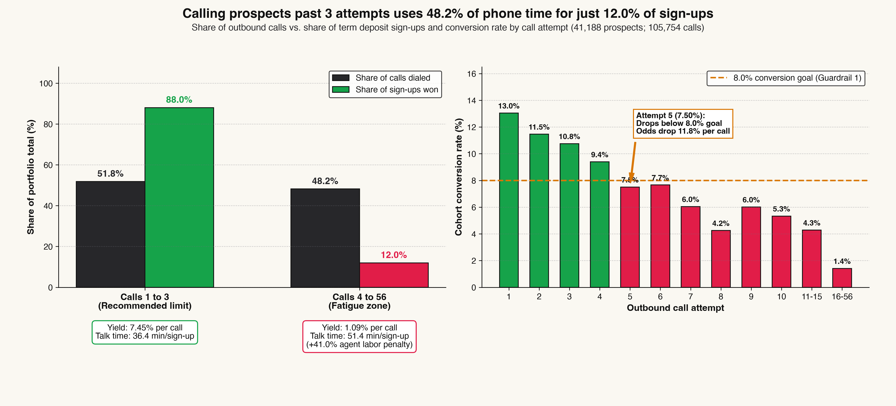
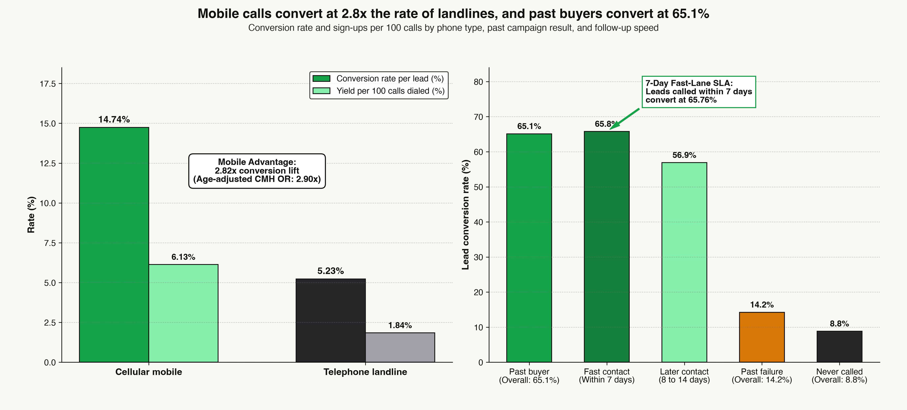
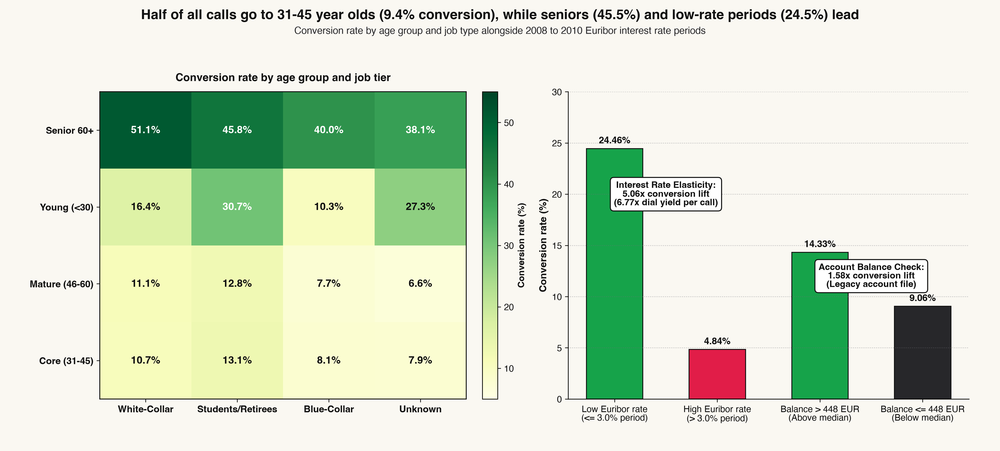
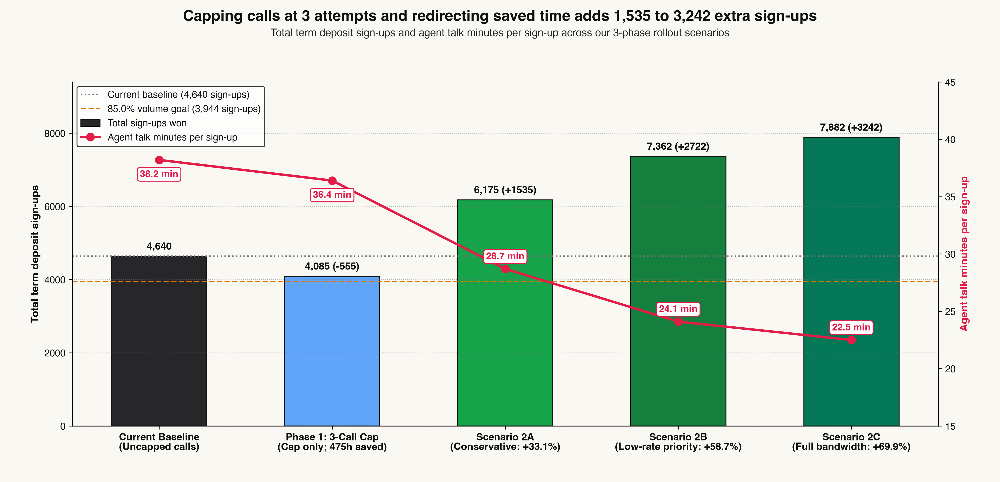

# Outbound Call Center and Marketing Strategy: Bank Direct Marketing

> **Executive Quick Links:**
> - [View Stakeholder Editorial Report (`index.html`)](file:///Users/jamores/Documents/[02]%20Work/[01]%20Github-Repo/data-analyst-portfolio/bank-marketing-crm/index.html)
> - [Open Interactive Call-Cap Simulator (`cockpit.html`)](file:///Users/jamores/Documents/[02]%20Work/[01]%20Github-Repo/data-analyst-portfolio/bank-marketing-crm/cockpit.html)

---

## Project Overview

Between May 2008 and November 2010, Banco de Portugal dialed 105,754 outbound telemarketing calls across 41,188 prospects to sell retail term deposits. Overall, 4,640 customers agreed to open an account, achieving an 11.27% conversion rate per lead and an average yield of 4.39 sign-ups for every 100 calls dialed.

When we audited call center operations by attempt number, we identified a massive misallocation of rep bandwidth. Outbound agents contacted unresponsive leads up to 56 times in a single campaign cycle. While calls 1 through 3 brought in 88.04% of all sign-ups (4,085 deposits), nearly half of all outbound volume (50,949 calls, or 48.18% of call center dials) went to prospects on their 4th through 56th attempt. Those extra 50,949 calls yielded just 555 deposits, cutting conversion yield per call from 7.45% down to 1.09% and driving agent phone time per sign-up up by 41.0% (from 36.4 minutes to 51.4 minutes).

Simultaneously, dialer queues were aimed at the lowest-converting prospects. Over 53% of calls went to working-age adults (ages 31 to 45), who converted at just 9.37%. Meanwhile, seniors aged 60 and older converted at 45.49%, students converted at 31.43%, and prior campaign buyers converted at 65.11%. Mobile cellular outreach also outperformed fixed landlines by nearly three to one (14.74% vs. 5.23%).

By putting a strict 3-call cap in place, the bank immediately recovers 28,044 to 50,949 phone calls (475.2 hours of agent talk time) while preserving 88.04% of term deposit volume. Reallocating those saved calls to mobile numbers, warm leads, and high-affinity age groups adds 1,535 to 3,242 net new term deposits (+33.1% to +69.9%) with zero added headcount.

---

## Executive Decision Framework (The 4-Question Table)

| Executive Question | Operational Finding | Strategic Decision & Impact |
| :--- | :--- | :--- |
| **1. What did we find?** | Calls 1 to 3 capture 88.04% of sign-ups (4,085 deposits). Calls 4 to 56 consume 48.18% of all outbound calls (50,949 dials) for only 11.96% of sign-ups. | Establish a hard policy limit at 3 call attempts per prospect per campaign. |
| **2. Why is this happening?** | The dialer has no repeat cap, and 53.1% of calls target 31-45 year olds (9.37% conversion) or landlines (5.23% conversion) rather than mobile phones (14.74%), seniors (45.49%), and past buyers (65.11%). | Reconfigure dialer routing logic to prioritize mobile numbers, seniors, and past buyers. |
| **3. What does it cost us?** | Reps spend 475.2 hours of talk time on 4+ calls. Closing a deposit on attempt 4+ requires 51.37 minutes of talk time vs. 36.42 minutes on attempts 1 to 3 (+41.0% labor penalty). | Bank 475.2 hours in direct payroll savings or reinvest that capacity into high-odds leads. |
| **4. What should we change?** | Execute a 3-phase rollout: Cap calls at 3 attempts (Phase 1), route to mobile lines and 7-day past buyers (Phase 2), and pace calling lists by age and interest rates (Phase 3). | Generates +1,535 to +3,242 incremental term deposit sign-ups (+33.1% to +69.9%). |

---

## Four-Layer Metric Model

### Layer 1: North Star Metrics (Commercial & Operational Efficiency)
- **Lead Conversion Rate:** 11.27% baseline (4,640 deposits across 41,188 client records).
- **Outbound Dialing Yield:** 4.39% baseline (4,640 deposits across 105,754 total outbound calls dialed).

### Layer 2: Guardrail Metrics (Fatigue Boundaries & Volume Protection)
- **Guardrail 1 (Marginal Conversion Yield):** Marginal conversion at each attempt must remain at or above 8.0%. Touches 1 to 4 pass (13.04%, 11.46%, 10.75%, 9.39%), while attempt 5 drops to 7.50%, permanently breaching Guardrail 1.
- **Guardrail 2 (Pipeline Volume Preservation):** Retained term deposit volume under capping policies must remain at or above 85.0% of baseline volume. Capping at 3 attempts retains 4,085 deposits (88.04%), safely beating the 85.0% threshold.

### Layer 3: Secondary Operational Metrics
- **Bandwidth Consumption Ratio:** 51.82% of calls spent on attempts 1 to 3 vs. 48.18% on attempts 4+.
- **Labor Acquisition Penalty:** 36.42 minutes of phone time per deposit on attempts 1 to 3 vs. 51.37 minutes on attempts 4+ (+41.0% labor penalty).
- **Channel Conversion Ratio:** Cellular mobile converts at 14.74% vs. landlines at 5.23% (2.82x ratio).

### Layer 4: Data Quality and Integrity Guardrails
- **Zero Post-Call Leakage:** Quarantine call duration from pre-call lead scoring models.
- **Sentinel Code Resolution:** Map all 39,673 records with `pdays == 999` to `was_previously_contacted == 0`.
- **Explicit Unknown Governance:** Keep all 10,700 records with missing profile attributes visible rather than using naive imputation.

---

## Data Setup and Cleaning Summary (ISS-01 to ISS-05)

1. **ISS-01: Post-Call Duration Data Leakage Quarantine**
   Because call duration is known only after a customer hangs up, using duration in pre-call targeting models creates severe data leakage. We quarantined duration and produced two independent data views: `data/cleaned/fct_campaign_precall_targeting.parquet` (33 features, zero leakage) and `data/cleaned/fct_campaign_full_operational.parquet` (35 features, retaining duration for labor cost accounting).

2. **ISS-02: Sentinel Value `pdays == 999` Resolution**
   In the raw file, 39,673 prospects (96.32%) had `pdays == 999`. Instead of treating 999 as roughly three years, we mapped these records to `was_previously_contacted == 0` (converting at 9.26%) and separated previously contacted prospects (converting at 63.83%).

3. **ISS-03: Explicit 'unknown' Category Governance**
   Rather than dropping rows or guessing missing values, we tracked the 10,700 prospects (25.98%) with 'unknown' listed on credit or background fields. Prospects with incomplete records converted at 7.30% compared to 12.66% for complete profiles (a 1.73x drop).

4. **ISS-04: Exact Row Deduplication Audit**
   Identified and flagged 12 exact duplicate rows (`is_exact_duplicate == 1`), preserving baseline comparability across all 41,188 rows while enabling deduplicated filtering to 41,176 records.

5. **ISS-05: Cross-Dataset Balance Enrichment Benchmark**
   Reconciled the older 45,211-row file (`bank-full.csv`) against the newer 41,188-row file (`bank-additional-full.csv`). Confirmed that clients with account balances above the 448 EUR median convert at 14.33% vs. 9.06% for lower balances (1.58x lift).

---

## Key Findings and Statistical Analysis

### Key Finding 1: The Contact Fatigue Cliff (Calls 1 to 3 vs. Calls 4+)



Outbound sales calls exhibit steep diminishing returns past attempt 3:
- Calls 1 to 3: 54,805 calls (51.82% of volume) yield 4,085 deposits (88.04% of total sign-ups), with 7.45% yield per call and 36.42 talk minutes per sign-up.
- Calls 4 to 56: 50,949 calls (48.18% of volume) yield 555 deposits (11.96% of total sign-ups), with 1.09% yield per call and 51.37 talk minutes per sign-up (+41.0% labor penalty).
- Statistical Verification: Chi-Square = 149.24, p < 0.0001; Odds decrease by 11.8% per additional dial (OR = 0.882, p < 0.0001); Welch t-test on talk time = 12.85, p < 0.0001.

---

### Key Finding 2: Channel Multiplier and Prior Buyer Fast-Lane



- Mobile cellular calls convert at 14.74% (6.13% yield per call) vs. landlines at 5.23% (1.84% yield per call), delivering a 2.82x conversion lift (age-adjusted CMH odds ratio: 2.90x, p < 0.0001).
- Past campaign buyers convert at 65.11% (36.00% yield per call), delivering a 7.37x lift over uncontacted leads.
- Prospects contacted within 7 days convert at 65.76%, compared to 56.88% when reps wait 8 to 14 days.

---

### Key Finding 3: Demographic Affinity and Macroeconomic Regimes



- Over half of all calls (56,174 dials) target 31-45 year olds, who convert at just 9.37%.
- Under-contacted high-affinity segments lead conversion: Seniors aged 60+ convert at 45.49% (White-collar seniors reach 51.06%), and students convert at 31.43%.
- During low-interest-rate periods (Euribor <= 3.0%), retail depositors convert at 24.46% (11.69% yield per call) vs. 4.84% during high-rate periods (Euribor > 3.0%), representing a 5.06x conversion lift.
- Multivariate Pre-Call Propensity Model (ROC-AUC = 0.7704):
  - Past campaign success: 9.07x odds
  - Low Euribor rate <= 3.0%: 3.98x odds
  - Senior 60+: 1.72x odds
  - Student / Retiree: 1.64x odds
  - White-collar: 1.30x odds
  - Incomplete profile: 0.77x odds
  - Core working 31-45: 0.78x odds
  - Landline phone: 0.69x odds
  - Each extra call attempt: 0.94x odds

---

### Key Finding 4: Strategic Rollout Scenarios



| Scenario Name | Calls Dialed | Calls Saved | Sign-Ups Won | Net Gain | Yield / Call | Hours Saved | Min / Sign-Up |
| :--- | :--- | :--- | :--- | :--- | :--- | :--- | :--- |
| **Scenario 0 Baseline** | 105,754 | 0 | 4,640 | 0 | 4.39% | 0.0 hrs | 38.2 min |
| **Scenario 1A: Cohort Cap** | 54,805 | 50,949 | 4,085 | -555 (88.04% kept) | 7.45% | 475.2 hrs | 36.4 min |
| **Scenario 1B: Truncated Cap** | 77,710 | 28,044 | 4,085 | -555 (88.04% kept) | 5.26% | 475.2 hrs | 36.4 min |
| **Scenario 2A: Conservative** | 105,754 | 0 | 6,175 | +1,535 (+33.1%) | 5.84% | Reinvested | 28.7 min |
| **Scenario 2B: Low-Rate Queue** | 105,754 | 0 | 7,362 | +2,722 (+58.7%) | 6.96% | Reinvested | 24.1 min |
| **Scenario 2C: Full Reallocation** | 105,754 | 0 | 7,882 | +3,242 (+69.9%) | 7.45% | Reinvested | 22.5 min |

---

## 90-Day Operational Rollout Plan

| Rollout Phase | Recommended Action | Target Group | Team Owner | Expected Impact | Tracking Metric |
| :--- | :--- | :--- | :--- | :--- | :--- |
| **Phase 1: Immediate (Days 1 to 30)** | **Cap Outbound Calls at 3 Attempts** | All prospects reaching attempt 3 without signing up (7,635 past leads; 50,949 total dials) | **Call Center Operations Manager** | **Frees up 28,044 to 50,949 calls** and saves **475.2 hours** of phone time while keeping **88.04%** of sign-ups (4,085 deposits) | Conversion rate on active calls stays above **8.0%**; kept sign-ups stay above **85.0%**. |
| **Phase 2: Near-Term (Days 30 to 60)** | **Mobile-First Routing & 7-Day Past Buyer Fast-Lane** | Prospects with mobile numbers (26,144 leads) and prior campaign contacts (1,515 leads, especially <=7 days) | **CRM & Dialer Routing Team** | **Lifts channel conversion from 5.23% to 14.74% (2.82x)** and captures **65.11%** conversion on past buyers | Share of daily dials routed to mobile numbers and % of warm leads called within 7 days. |
| **Phase 3: Ongoing (Days 60 to 90)** | **Pre-Call Lead Scoring & Interest Rate Pacing** | Shift dialer share from 31-45 working cohorts (9.37%) toward Seniors 60+ (45.49%), Students (31.43%), complete profiles (12.66%), and low-Euribor windows (24.46%) | **VP of Growth Marketing** | **Adds +1,535 to +3,242 net new sign-ups (+33.1% to +69.9%)** using the exact same call volume (105,754 calls) | Overall campaign yield climbs from **4.39% to 5.84%-7.45%** sign-ups per 100 calls; talk time drops to **22.5-28.7 min/sign-up**. |

---

## Repository Structure and CLI Commands

```text
bank-marketing-crm/
|-- assets/
|   |-- fig1_contact_fatigue_cliff.png
|   |-- fig2_channel_poutcome_matrix.png
|   |-- fig3_macro_demographic_heatmap.png
|   `-- fig4_policy_reallocation_waterfall.png
|-- cockpit.html
|-- data/
|   |-- cleaned/
|   |   |-- fct_campaign_full_operational.parquet
|   |   |-- fct_campaign_precall_targeting.parquet
|   |   `-- fct_legacy_balance_benchmark.parquet
|   |-- exports/
|   |   |-- contact_fatigue_curve.csv
|   |   |-- h1_fatigue_econometrics.csv
|   |   |-- h2_channel_poutcome_matrix.csv
|   |   |-- h3_multivariate_odds_ratios.csv
|   |   |-- h3_policy_simulation.csv
|   |   `-- operational_labor_audit.csv
|   `-- raw/
|       |-- bank-additional-full.csv
|       `-- bank-full.csv
|-- docs/
|   |-- DATA_SPEC.md
|   `-- PROJECT_CHARTER.md
|-- index.html
|-- pytest.ini
|-- README.md
|-- reports/
|   |-- etl_cleaning_log.md
|   |-- h1_validation_results.json
|   |-- h2_validation_results.json
|   `-- h3_validation_results.json
|-- requirements.txt
|-- src/
|   |-- analytics/
|   |   |-- scan_aggregates.py
|   |   |-- scan_coverage.py
|   |   |-- scan_segments.py
|   |   |-- test_h1_contact_fatigue.py
|   |   |-- test_h2_channel_poutcome.py
|   |   `-- test_h3_macro_demographics.py
|   |-- etl/
|   |   `-- clean_campaigns.py
|   `-- presentation/
|       `-- export_figures.py
`-- tests/
    |-- test_clean_schema.py
    |-- test_hypotheses.py
    |-- test_presentation_assets.py
    |-- test_raw_schema.py
    `-- test_scan_analytics.py
```

### Reproduction Commands

```bash
# 1. Run data engineering clean pipeline
./.venv/bin/python src/etl/clean_campaigns.py

# 2. Run econometric verification hypotheses
./.venv/bin/python src/analytics/test_h1_contact_fatigue.py
./.venv/bin/python src/analytics/test_h2_channel_poutcome.py
./.venv/bin/python src/analytics/test_h3_macro_demographics.py

# 3. Export 300-DPI publication figures
./.venv/bin/python src/presentation/export_figures.py

# 4. Run automated test suite
./.venv/bin/pytest -v
```
