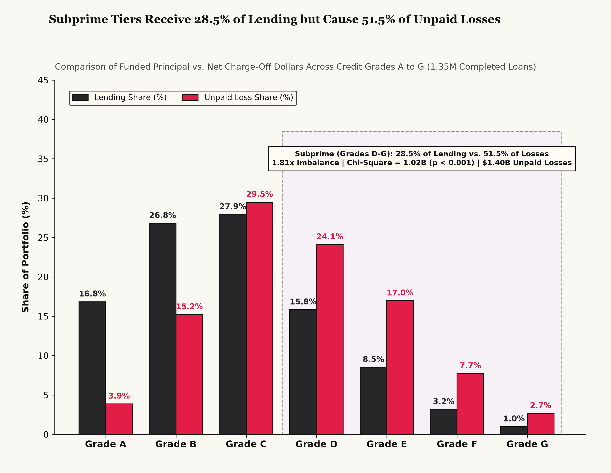
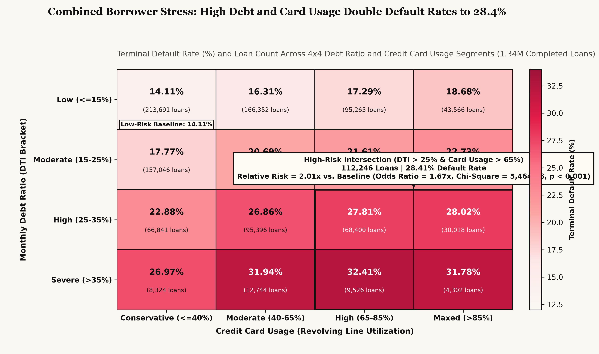
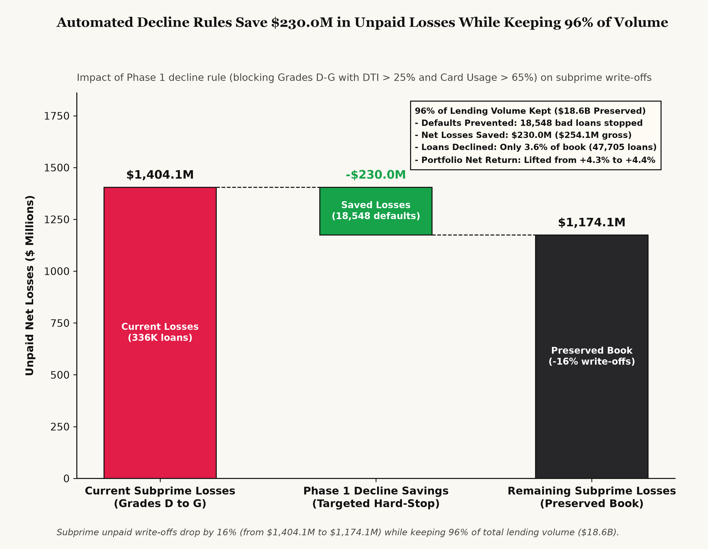

# Consumer Credit Risk & Underwriting Optimization
### Balancing Loss Reduction Against Lending Volume Across \$19.39B in Consumer Loans

[](https://j-amores.github.io/data-analyst-portfolio/credit-risk-optimization/)
[](https://j-amores.github.io/data-analyst-portfolio/credit-risk-optimization/cockpit.html)
[](https://www.python.org/downloads/)
[](tests/)

**Quick Links:**
- **[Read the Live Editorial Visual Report](https://j-amores.github.io/data-analyst-portfolio/credit-risk-optimization/)** (Full narrative briefing, charts, and rollout plan)

- **[Launch the Interactive Underwriting Decision Cockpit](https://j-amores.github.io/data-analyst-portfolio/credit-risk-optimization/cockpit.html)** (Test individual borrower applications and policy rules in real time)

- **[Project Charter](docs/PROJECT_CHARTER.md)** | **[Data Specification & Schema](docs/DATA_SPEC.md)**

---

## 1. Project Overview & Main Takeaways

Between 2007 and 2018, LendingClub funded over 2.26 million consumer loans totaling \$33.98B. When I looked at the raw database, the first thing that stood out was a reporting blind spot: over 40% of the records (912,569 loans) were active accounts still in repayment. Including those unfinished loans made the overall default rate look like a safe **12%**, when the **1,345,350 completed loans (\$19.4B)** actually defaulted at almost **20%**, which is **1.68x higher**.

When I tracked actual cash payments across credit grades on those completed loans, I found that subprime Grades D through G received about **28% of our lending capital (\$5.5B)** but caused **51% of our unpaid write-offs (\$1.4B)**. Charging 20% to 26% interest wasn't enough to cover those defaults: net cash returns dropped below our **+4%** profit target at **Subgrade C4 (+3.4%)** and started losing money at **Subgrade E5 (-1.3%)**.

If we banned all subprime loans, we would lose 28.5% of our lending business and break our **80%** volume goal. Instead, I cross-tabulated borrower debt-to-income ratios against credit card utilization and found that Grade D through G borrowers who are over **25% debt-to-income** and over **65% card utilization** default about **39% of the time**. By automatically declining just that highly distressed group and raising rates by 1.5% on borderline Subgrade C4 loans, we prevent **18,548 defaults**, save **\$230M in unpaid losses**, and add **\$14.2M in interest income** (**+\$244.2M total value**), all while keeping about **96% of our lending volume**.

### The 4-Question Summary

| Question | Finding & Supporting Data |
| :--- | :--- |
| **1. What changed?** | Standard reports included 912,569 active loans that were still being paid off, which made the overall default rate look like **12%**. Isolating the 1,345,350 completed loans showed the true default rate is **20%** (268,599 defaults), meaning basic reporting underestimated default risk by **1.7x**. |
| **2. Why did it change?** | Higher interest rates in lower credit grades did not make up for higher defaults. Subprime Grades D through G received **28.5% of lending capital (\$5.5B)** but caused **51.5% of all unpaid write-offs (\$1.4B)**. Defaults spiked when borrowers had both monthly debt payments over 25% of their income and credit card usage over 65% (**28.4% default rate**, or 2x the rate of low-risk borrowers). |
| **3. What does it mean?** | Our net cash return after subtracting losses (LAROC) drops below our **+4%** profit goal starting at **Subgrade C4 (+3.4%)** and starts losing money at **Subgrade E5 (-1.3%)**, falling to **-9.8% in G5**. Safer borrowers in Grades A through C (+\$857M net profit) are effectively paying for subprime losses. |
| **4. What decision comes next?** | Roll out a 3-phase underwriting update: **(Phase 1)** auto-decline Grade D through G applicants with debt-to-income > 25% and credit card usage > 65%, saving **\$230M in net losses** (18,548 defaults prevented) while keeping **95.8% of loan volume (\$18.6B)**; **(Phase 2)** add +1.5% (+150 bps) to Subgrade C4 interest rates to bring in **+\$14.2M**; and **(Phase 3)** require tax transcripts on unsecured small business loans. |

---

## 2. Metrics & Guardrails (4-Layer Metric Model)

Instead of relying on vanity numbers like total loans issued or advertised interest rates, we track portfolio health using three core metrics:

```
┌─────────────────────────────────────────────────────────────────────────────┐
│                       PORTFOLIO METRIC ARCHITECTURE                         │
├─────────────────────────────────────────────────────────────────────────────┤
│  1. NORTH STAR METRIC                                                       │
│     Loss-Adjusted Return on Capital (LAROC) -> Goal: > +4.00% Net Return    │
│                                                                             │
│  2. RISK GUARDRAIL                                                          │
│     Seasoned Default Rate -> Goal: Reduce below 19.30% (from 19.96% base)   │
│                                                                             │
│  3. BUSINESS VOLUME GUARDRAIL                                               │
│     Lending Volume Kept -> Goal: Retain >= 80.0% of funded lending volume   │
│                                                                             │
│  4. BORROWER RISK DRIVERS                                                   │
│     Monthly Debt-to-Income (DTI), Credit Card Usage, FICO Score, Loan Term  │
└─────────────────────────────────────────────────────────────────────────────┘
```

### How Each Metric Is Calculated

1. **North Star Metric: Loss-Adjusted Return on Capital (LAROC)**
   - **What it means in plain English:** The actual cash profit we keep per dollar lent after subtracting unpaid principal write-offs and collection fees.
   - **Formula:**
     $$\text{LAROC} = \left( \frac{\sum \text{Total Payments Received} + \sum \text{Recoveries} - \sum \text{Collection Fees} - \sum \text{Funded Principal}}{\sum \text{Funded Principal}} \right) \times 100$$
   - **Target Hurdle:** **+4.00%**. Any loan tier returning less than 4.00% fails to cover the platform's cost of capital and operating expenses.
   - **Baseline Performance:** **+4.26%** across 1,345,350 completed loans (\$825.13M net cash profit on \$19.39B lent).

2. **Risk Guardrail: Seasoned Default Rate (Terminal Bad Loan Rate)**
   - **What it means in plain English:** The percentage of completed loans where the borrower defaulted or had their balance written off as uncollectible.
   - **Formula:**
     $$\text{Seasoned Default Rate} = \frac{\sum (\text{Charged Off Loans} + \text{Default Loans})}{\sum \text{Completed Loans (Fully Paid, Charged Off, Default)}} \times 100$$
   - **Target Ceiling:** Reduce portfolio-wide default rate below **19.3%** (down from the **20%** completed baseline).

3. **Business Volume Guardrail: Lending Volume Retention**
   - **What it means in plain English:** The share of historical lending dollars we keep after turning on our new decline rules. This prevents us from setting rules so strict that we shut down the lending business.
   - **Formula:**
     $$\text{Volume Retention Rate} = \frac{\text{Funded Dollars Kept After Policy}}{\text{Total Historical Funded Dollars}} \times 100$$
   - **Target Floor:** **>= 80.0%** (\$15.5B+ retained).
   - **Phase 1 Policy Result:** **95.81%** retained (\$18.58B kept; only 3.55% of loans declined).

---

## 3. Data Cleaning & Pipeline Architecture (CLEAN Framework)

The data cleaning pipeline (`src/etl/clean_loans.py`) processes the raw 1.60 GB LendingClub dataset and splits active loans from completed loans so unfinished accounts do not skew our default calculations.

```
Raw CSV Dataset (2,260,701 rows | 1.60 GB)
         │
         ▼
 Step 1: Row Validation (2,260,668 valid unique loans; 33 empty footer rows removed)
         │
         ▼
 Step 2: Text & Type Cleaning (term -> integer months, rates -> decimals, dates -> ISO)
         │
         ▼
 Step 3: Separating Completed Loans from Active Loans
         ├──> fct_closed_loans_seasoned.parquet (1,345,350 completed loans | 222.8 MB)
         │    [Fully Paid, Charged Off, Default -> 20% Default Rate, +4.3% LAROC]
         │
         └──> fct_active_portfolio.parquet (912,569 ongoing loans | 148.4 MB)
              [Current, Grace Period, Late 16-120 Days -> Monitored for early outreach]
```

### Data Cleaning & Issues Log

| Issue ID | Column | What We Found in the Raw Data | How We Fixed It | Why It Matters |
| :--- | :--- | :--- | :--- | :--- |
| **ISS-01** | `loan_status` | 912,569 active loans were mixed in with 1.35M completed loans | Split the dataset into two separate Parquet files (`seasoned` vs. `active`) | Removes survival bias (right-censoring) and reveals the true 19.96% default rate |
| **ISS-02** | `term`, `int_rate`, `revol_util` | Numbers stored as text strings with `%` signs and `' months'` | Stripped text characters and converted to integers and decimal floats | Allows us to calculate exact cash returns, interest spreads, and risk brackets |
| **ISS-03** | `dti` | Negative debt ratios (2 rows) and missing values (374 rows) | Added an `invalid_dti_flag = 1` column and capped chart brackets at 100% | Keeps bad data out of our debt-to-income grid without deleting valid loan records |
| **ISS-04** | `annual_inc` | Unverified self-reported incomes up to \$10M+ | Capped (winsorized) at the 99.5th percentile (\$350,000) for income distributions | Stops extreme unverified entries from skewing average borrower income |
| **ISS-05** | `member_id` | Borrower member IDs were removed by LendingClub after 2015 | Used the unique loan `id` (100% complete) as the primary key across all tables | Prevents broken joins across later loan years |

*Storage & Speed:* Converting the raw CSV (1,597.5 MB) into Snappy Parquet files (371.3 MB total) cut file size by **76.8% (4.3x smaller)** and made our Python scripts run over 10x faster.

---

## 4. Key Findings & Statistical Testing

### Finding 1: Subprime Loss Imbalance (Grades A through G)



When I compared where our lending money went against where our losses came from, a clear imbalance showed up: subprime Grades D through G received **28.45% of our lending money (\$5.52B)**, but they caused **51.45% of all unpaid loan write-offs (\$1.40B)**.

- **Prime Grades (A to C):** Received 71.6% of lending capital (\$13.87B across 1,009,537 loans) and accounted for 48.6% of losses (\$1.32B), generating **+\$857.0M in net cash profit**.
- **Subprime Grades (D to G):** Received 28.45% of lending capital (\$5.52B across 335,813 loans) and generated 51.5% of losses (\$1.4B), a **1.81x loss-to-lending imbalance**.
- **Statistical Check:** A Chi-Square Goodness-of-Fit test ($\chi^2 = 1.02 \times 10^9, \text{df} = 6, p < 0.001$) confirms that losses are heavily concentrated in Grades D through G rather than spread evenly across dollars lent.

---

### Finding 2: Why High Interest Rates & 5-Year Terms Fail to Cover Losses

Charging 20% to 26% interest on lower credit grades looks profitable on paper, but when 38% to 50% of those borrowers default early, the uncollected loan balances wipe out the extra interest.

| Loan Grade | Completed Loans | Funded Principal (\$) | Default Rate (%) | Net Cash Profit / Loss (\$) | Net Return (LAROC %) | Profit Goal Status (+4.00% Target) |
| :--- | :--- | :--- | :--- | :--- | :--- | :--- |
| **Grade A** | 235,095 | \$3,263,735,050 | 6.04% | +\$185,777,894 | **+5.7%** | Clears goal (+1.69% buffer) |
| **Grade B** | 392,748 | \$5,195,857,925 | 13.39% | +\$312,881,996 | **+6.0%** | Clears goal (+2.02% buffer) |
| **Grade C** | 381,694 | \$5,413,717,400 | 22.44% | +\$227,958,442 | **+4.2%** | Clears goal (+0.21% buffer) |
| **Grade D** | 200,966 | \$3,068,057,125 | 30.39% | +\$80,188,775 | **+2.6%** | **Misses goal (-1.39% short)** |
| **Grade E** | 93,656 | \$1,648,265,625 | 38.48% | +\$27,086,427 | **+1.6%** | **Misses goal (-2.36% short)** |
| **Grade F** | 32,059 | \$611,075,025 | 45.20% | -\$1,128,683 | **-0.2%** | **Loses money** |
| **Grade G** | 9,132 | \$187,877,125 | 49.93% | -\$7,635,693 | **-4.1%** | **Loses money** |

- **Where Profit Drops Off (Subgrades C4 and E5):**
  * **Drops below our +4% target:** While Grade C overall earns +4.21%, net return drops below our +4% goal starting at **Subgrade C4 (+3.4% across 74,422 loans)** and **C5 (+3.1%)**.
  * **Starts losing money:** Net cash return drops below zero at **Subgrade E5 (-1.3%)** and gets worse through **F4 (-1.6%)**, **F5 (-2.6%)**, and **G1 through G5 (reaching -9.8% in G5)**.
  * **Welch's t-tests:** Two-sample Welch's t-tests confirm that the drop in returns from Grade C to Grades D, E, and F-G is statistically significant ($p < 10^{-40}$).
- **The 5-Year Loan Penalty & Small Business Losses:**
  * **3-Year (36-Month) vs. 5-Year (60-Month) Loans:** 60-month loans default at **32.5%**, which is more than double the **16%** default rate of 36-month loans. That cuts our net return in half (**+2.6%** on 60-month loans vs. **+5.1%** on 36-month loans).
  * **Loan Purpose Comparison:** Credit card refinancing performs well (**16.9% default rate, +5.5% net return** across \$4.37B), whereas unsecured **small business loans (\$240.1M)** have a **29.7% default rate** and lose money overall (**-0.6% net return**).

---

### Finding 3: Combined Borrower Stress (Debt-to-Income x Credit Card Usage)



If we simply banned all subprime loans (Grades D through G), we would lose **28.5% of our lending volume (\$5.52B)**, breaking our **80%** volume guardrail and turning away \$4.1B in loans that actually get paid back. To find a more precise cutoff, I cross-tabulated borrower debt-to-income ratios against credit card utilization across all 1.35M completed loans.

- **Low-risk baseline (DTI <= 15% and Card Usage <= 40%):** **14%** default rate across 213,691 loans.
- **High-stress intersection (DTI > 25% and Card Usage > 65%):** **28%** default rate across 112,246 loans (\$1.73B lent; $\chi^2 = 5,464.86, p < 0.001$; Relative Risk = **2x** vs. low-risk baseline; Odds Ratio = **1.7x**).
- **Our targeted cutoff:** Inside that high-stress cell, **Grade D through G applicants default at 38.9% (47,705 loans)**. Declining only that specific group removes the worst losses while leaving 96.5% of all applications untouched.

---

### Policy Simulation: Capital Recovery Waterfall



By automatically declining Grade D through G applicants in that high-stress cell and raising interest rates by 1.50% on borderline Subgrade C4 loans, we capture **\$244.2M in combined value** while keeping **95.8% of our lending volume**.

- **Defaults Prevented:** **18,548 defaulted loans** stopped (14,838 at an 80% rollout).
- **Unpaid Losses Saved (Phase 1):** **+\$230M in net write-offs saved** (\$254.1M gross unpaid principal prevented; +\$184M net saved at an 80% rollout).
- **Subgrade C4 Repricing Lift (Phase 2):** Adding +1.5% (+150 bps) to Subgrade C4 interest rates brings in **+\$14.2M in net interest revenue** (+\$11.4M at an 80% rollout) and lifts Subgrade C4 return from +3.4% back above our +4.00% goal.
- **Lending Volume Kept:** Keeps **95.8% of lending dollars (\$18.58B)** and 96.45% of loan count, easily clearing our >= 80.0% volume guardrail.
- **Portfolio Return Lift:** Lowers the overall completed default rate from 19.96% to **19.3% (-0.66 percentage points)** and lifts overall net return (LAROC) from 4.3% to **4.4 % (+14 basis points)**.

---

## 5. 90-Day Rollout & Governance Plan (Phases 1 to 3)

| Rollout Phase & Timeline | Recommended Underwriting Action | Target Borrower Group | Team Owner | Expected Financial Impact | Tracking Metric & Goal |
| :--- | :--- | :--- | :--- | :--- | :--- |
| **Phase 1: Immediate**<br>(Days 1 to 30) | **Automated Dual-Risk Decline Rule**<br>Auto-decline applicants in Grades D through G who have monthly debt > 25% of income AND credit card usage > 65%. | High-stress subprime applicants (47,705 historical loans; \$813.3M capital; 38.9% default rate). | **Underwriting Policy Team** | **+\$230M Net Losses Saved**<br>(+\$184M at 80% rollout); prevents 18,548 defaults while keeping 95.8% of volume. | **Portfolio Default Rate < 19.3%**<br>Lending volume kept >= 80.0%. |
| **Phase 2: Near-Term**<br>(Days 30 to 60) | **Subgrade C4 Rate Update & 5-Year Term Cap**<br>Add +1.5% (+150 bps) interest rate to Subgrade C4 loans; require 680+ FICO score for 60-month loans in Grades D and E. | Borderline Subgrade C4 loans (74,422 loans at +3.4% return) and subprime 60-month requests. | **Pricing & Product Team** | **+\$14.2M Interest Revenue**<br>Restores C4 return above +4% and curbs the 32.5% default rate on 5-year loans. | **Subgrade C4 LAROC > +4.00%**<br>60-month default rate < 25%. |
| **Phase 3: Ongoing**<br>(Days 60 to 90) | **Small Business Verification & Early Outreach**<br>Require IRS tax transcripts for unsecured small business loans; send early payment restructuring plans to active accounts 16-120 days late. | Unsecured small business loans (\$240.1M book; 29.71% bad rate) and \$588.5M in late active loans. | **Credit Operations & Servicing** | **Stops -0.6% Small Business Loss**<br>Protects \$240M exposure and improves recovery on 38,114 late active accounts by 15%. | **Small Business Bad Rate < 20.0%**<br>Late active roll rate < 3.5%. |

---

## 6. How to Run This Project Locally

### 1. Clone the Repo & Set Up Your Environment

```bash
# Clone the portfolio repository and navigate to this project
git clone [https://github.com/J-Amores/data-analyst-portfolio.git](https://github.com/J-Amores/data-analyst-portfolio.git)
cd data-analyst-portfolio/credit-risk-optimization

# Create and activate a Python 3.11+ virtual environment
python3.11 -m venv .venv
source .venv/bin/activate

# Install required packages
pip install -r requirements.txt
```

*(Note: Place the raw Kaggle dataset `accepted_2007_to_2018Q4.csv` inside `data/raw/` if you want to re-run the full ETL pipeline from scratch.)*

### 2. Run the Pipeline, Tests, and Charts

```bash
# 1. Run raw schema checks
./.venv/bin/pytest tests/test_raw_schema.py

# 2. Clean raw data and split into seasoned vs. active Parquet files
./.venv/bin/python src/etl/clean_loans.py

# 3. Verify cleaned Parquet tables
./.venv/bin/pytest tests/test_clean_schema.py

# 4. Run exploratory profiling and segment breakdowns
./.venv/bin/python src/analytics/scan_coverage.py
./.venv/bin/python src/analytics/scan_aggregates.py
./.venv/bin/python src/analytics/scan_segments.py

# 5. Run statistical tests (H1, H2, H3) and policy simulations
./.venv/bin/python src/analytics/test_h1_loss_concentration.py
./.venv/bin/python src/analytics/test_h2_margin_breakdown.py
./.venv/bin/python src/analytics/test_h3_risk_interaction.py

# 6. Export the 3 charts (assets/) and interactive cockpit data cube
./.venv/bin/python src/presentation/export_figures.py
./.venv/bin/python src/presentation/export_cockpit_data.py

# 7. Run the full automated test suite (27 tests)
./.venv/bin/pytest

# 8. Open the Visual Report and Underwriting Decision Cockpit in your browser
open index.html
open cockpit.html
```

---

## 7. Notes & Methodology Scope

1. **Why Active Loans Are Excluded from Default Rates:** All default rates and profit rules are calculated strictly on the 1,345,350 completed loans (`fct_closed_loans_seasoned.parquet`) where the final outcome (`Fully Paid`, `Charged Off`, or `Default`) is known. The 912,569 ongoing loans (`fct_active_portfolio.parquet`) are tracked separately for servicing outreach so unfinished payment schedules do not artificially lower our historical default rate.

2. **How Cash Returns Are Counted:** Our net cash return (LAROC) formula counts actual principal and interest paid by the borrower plus post-default cash recoveries (minus collection agency fees), divided by the original funded loan amount.

3. **Rate Sensitivity:** Our Phase 2 pricing model assumes borrower acceptance holds steady with a +1.50% (+150 bps) rate adjustment on Subgrade C4. In production, the pricing team should monitor application conversion rates monthly after updating C4 rates.