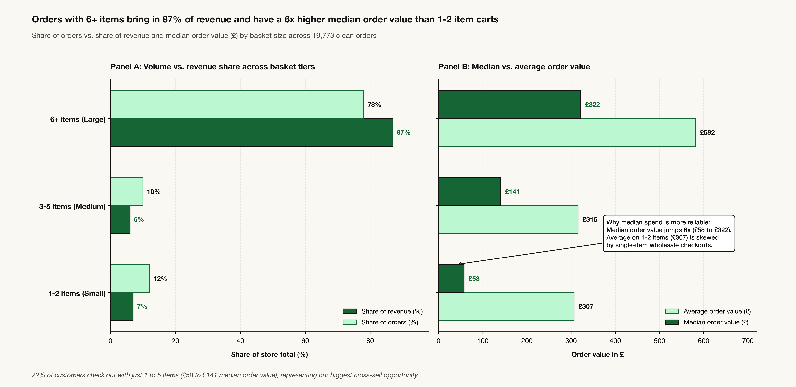
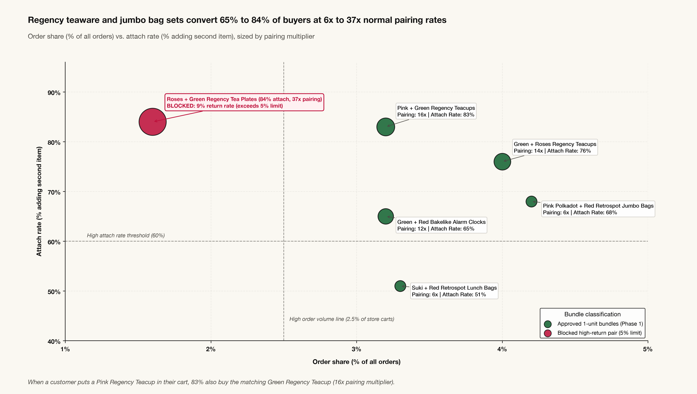
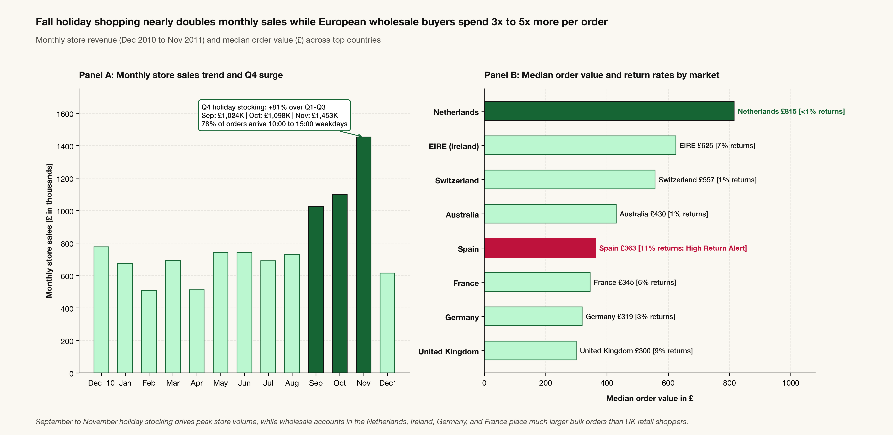
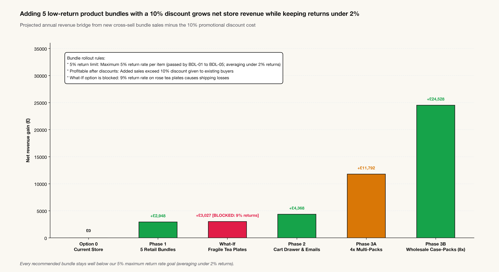

# Turning Single-Item Shoppers Into Multi-Item Buyers With Product Bundles

[](https://www.python.org/)
[](tests/)
[](data/cleaned/)
[](data/cleaned/)

An end-to-end data pipeline, customer buying pattern analysis, financial simulation, and executive merchandising plan built from 541,909 invoice records and 19,773 clean checkouts (£10.2M sales).

---

### Interactive Case Study & Decision Tool
* **[Executive Editorial Case Study (index.html)](index.html):** Complete stakeholder presentation in warm archival paper styling featuring click-to-enlarge chart lightboxes, four-way ledger reconciliations, and a structured 90-day rollout plan.
* **[Interactive Product Bundle & Discount Tester (cockpit.html)](cockpit.html):** Live merchandising decision tool with 6 one-click preset buttons, discount and audience toggles, real-time return safety checks, and an interactive margin waterfall chart.

---

## 1. Executive Summary & Business Opportunity

Over 12 months, our online store completed 19,773 clean merchandise orders totaling £10.2M in sales across 3,910 products. Because we serve both everyday retail shoppers and wholesale gift shops, our typical order sits at a median of 15 items worth £302 (average of 26 items worth £518).

When we grouped orders by cart size, we found a clear revenue gap:
* **Large Baskets (6+ items):** Make up 78% of orders and generate 87% of store revenue (£8.9M), with a median order value of £322.
* **Small & Medium Baskets (1-5 items):** Account for 22% of checkouts (4,354 orders), but yield a median order value of only £58 for 1-2 items and £141 for 3-5 items.

Right now, product pages do not suggest companion items when a customer adds a product to their cart. Shoppers come in for a single teacup, storage bag, or alarm clock and check out alone. Yet across our store catalog, five matching product families are naturally bought together 51% to 84% of the time, pairing 6x to 37x more often than random chance.

At the same time, cancelled orders and returns cost the store £897K (9% of gross sales). Promoting fragile items in discounted bundles would multiply shipping losses. To protect our operating margin, we set a strict **5% maximum return limit**: any product with a return rate of 5% or higher is held back for packaging upgrades, clearing five durable, low-return product bundles that average under 2% returns.

### The 4-Question Executive Decision Summary

| Executive Question | Findings and Practical Resolution |
| :--- | :--- |
| **What did we find?** | Orders with 6+ items bring in 87% of store sales (£322 median order), while 22% of orders leave with just 1 to 5 items (£58 to £141 median order). Across the catalog, five matching product sets are bought together 6x to 37x more often than chance. |
| **Why is this happening?** | Shoppers buying teaware sets, storage bags, or lunch bags want matching colors and styles, but without a "Complete the Set" prompt on the product page, 1-2 item shoppers miss the matching pieces. |
| **What does it cost us?** | Small 1-2 item orders bring in a median of just £58 compared to £141 for 3-5 item orders (less than half the order value), while unscreened store promotions risk amplifying our £897K (9%) cancellation and return drag. |
| **What should we change?** | Add 1-click bundle widgets on the Top 5 product sets at a 10% bundle discount (Phase 1), add a cart-drawer prompt for 1-2 item checkouts (Phase 2), and tailor wholesale case-packs for EU buyers and Q4 holiday shoppers (Phase 3). |

---

## 2. Key Findings & Merchandising Insights

### Finding 1: The Basket Size Gap

Orders with 6 or more items generate 87% of revenue (£8.9M) with a £322 median order value. Looking at typical (median) order values removes the skew from rare bulk wholesale checkouts and reveals the true customer ladder: £58 for 1-2 items, £141 for 3-5 items, £230 for 6-15 items, £336 for 16-30 items, and £551 for 31+ items.



#### Basket Tier Breakdown Across 19,773 Orders

| Basket Size Tier | Orders | Order Share | Total Sales (£) | Sales Share | Median Order (£) | Average Order (£) |
| :--- | :--- | :--- | :--- | :--- | :--- | :--- |
| **1-2 items (Small)** | 2,313 | 12% | £711K | 7% | £58 | £307 |
| **3-5 items (Medium)** | 2,041 | 10% | £646K | 6% | £141 | £316 |
| **6-15 items** | 5,622 | 28% | £2.1M | 21% | £230 | £377 |
| **16-30 items** | 5,253 | 27% | £2.4M | 23% | £336 | £452 |
| **31+ items (Wholesale)** | 4,544 | 23% | £4.4M | 43% | £551 | £967 |
| **Total Store Portfolio** | **19,773** | **100%** | **£10.2M** | **100%** | **£302** | **£518** |

*Nudging a single-item customer (£58 median order) into a 3-5 item cart (£141) or a 6+ item cart (£322) grows order value by 2.4x to 6x without additional advertising spend.*

---

### Finding 2: Top Product Pairs & the 5% Return Guardrail

We analyzed co-purchase patterns across all store orders, screening candidate pairs using three plain-English metrics:
1. **Order Share:** Percentage of all store carts containing both items.
2. **Attach Rate:** Percentage of Item A buyers who also add Item B.
3. **Pairing Multiplier:** How many times more likely customers are to buy both items together compared to random chance.



#### Top Verified Pairs & Return Safety Audit

| Product Pair | Shared Orders | Order Share | Attach Rate | Pairing Multiplier | Return Rate | Bundle Status |
| :--- | :--- | :--- | :--- | :--- | :--- | :--- |
| **Green + Roses Regency Teacups** (22697 + 22699) | 767 | 4% | 76% | 14x | 2% | **PASS (BDL-01)** |
| **Pink + Green Regency Teacups** (22698 + 22697) | 632 | 3% | 83% | 16x | 2% | **PASS (BDL-01)** |
| **Roses + Green Regency Tea Plates** (23170 + 23171) | 319 | 2% | 84% | 37x | 9% | **BLOCKED: 9% RETURNS** |
| **Pink Polkadot + Red Retrospot Jumbo Bags** (22386 + 85099B) | 825 | 4% | 68% | 6x | 2% | **PASS (BDL-02)** |
| **Green + Red Bakelike Alarm Clocks** (22726 + 22727) | 640 | 3% | 65% | 12x | 1% | **PASS (BDL-03)** |
| **Suki + Red Retrospot Lunch Bags** (22383 + 20725) | 655 | 3% | 51% | 6x | 2% | **PASS (BDL-04)** |
| **Poppy's Playhouse Bedroom + Kitchen** (22745 + 22748) | 313 | 2% | 74% | 34x | 1% | **PASS (BDL-05)** |

#### Blocked Fragile Products (Transit Breakage Losses)
* **Regency Cakestand 3 Tier (SKU 22423):** Store #1 revenue item (£174K sales), but loses £10K to returns (5.3% return rate) due to transit breakage. Held back until foam packaging passes warehouse drop tests.
* **White Hanging Heart T-Light Holder (SKU 85123A):** Store #1 order volume item (2,265 orders), but suffers a 6% return rate (-£7K lost) due to thin glass and weld points breaking in transit.
* **Regency Tea Plate Roses (SKU 23170):** 84% attach rate, but 9% return rate causes packaging losses. Blocked from bundle discounts.

---

### Finding 3: Seasonality & European Wholesale Accounts

Weekday business hours (10:00 to 15:00 Monday through Friday) account for 78% of completed checkouts (15,375 orders), driven by retail shops replenishing stock. Store sales nearly double from September through November during fall holiday stocking.



#### Top Markets by Median Order Value & Return Rate

| Country | Orders | Gross Sales (£) | Median Order (£) | Average Order (£) | Return Rate | Strategic Role |
| :--- | :--- | :--- | :--- | :--- | :--- | :--- |
| **Netherlands** | 95 | £285K | £815 | £1,054 | <1% | Priority wholesale hub with near-zero returns |
| **EIRE (Ireland)** | 260 | £266K | £625 | £960 | 7% | High-value commercial export market |
| **Switzerland** | 51 | £56K | £557 | £780 | 1% | Low-return commercial accounts |
| **Australia** | 57 | £139K | £430 | £1,075 | 1% | Bulk case-pack market |
| **Spain** | 88 | £56K | £363 | £633 | 11% | **HOLD PROMOTIONS: High regional return rate** |
| **France** | 389 | £210K | £345 | £486 | 6% | Continental retail accounts |
| **Germany** | 457 | £229K | £319 | £463 | 3% | Steady, low-return wholesale hub |
| **United Kingdom** | 18,041 | £9.0M | £300 | £489 | 9% | Core domestic retail base |

---

### Finding 4: Financial Rollout Bridge Across 6 Policy Options

Our financial simulation models net store profit by subtracting the 10% promotional discount given to existing buyers from the new sales generated by converting solo buyers. At a 10% bundle discount, retail deployment adds £2,948 in net profit per cycle. Scaling to wholesale case-packs delivers £24,528 in net cycle profit.



#### 6-Option Rollout Simulation Comparison

| Rollout Option | Policy Scope | Discount | Conversion | Scale | Added Sales (£) | Discount Cost (£) | Net Profit Gain (£) | Max Return | Safety Status |
| :--- | :--- | :--- | :--- | :--- | :--- | :--- | :--- | :--- | :--- |
| **Option 0** | Current Store Baseline | 0% | 0% | 1x | £0 | £0 | **£0** | 0% | **BASELINE** |
| **Phase 1** | 5 Retail Bundles | 10% | 25% | 1x | £3,550 | -£602 | **+£2,948** | 4% | **APPROVED** |
| **What-If** | Fragile Tea Plates Included | 10% | 25% | 1x | £3,669 | -£642 | +£3,027 | 9% | **BLOCKED: 9% RETURNS** |
| **Phase 2** | Cart Prompts & Follow-Up Emails | 10% | 35% | 1x | £4,970 | -£602 | **+£4,368** | 4% | **APPROVED** |
| **Phase 3A** | 4x Multi-Packs | 10% | 25% | 4x | £14,199 | -£2,407 | **+£11,792** | 4% | **APPROVED** |
| **Phase 3B** | Wholesale Case-Packs (8x) | 10% | 25% | 8.32x | £29,534 | -£5,006 | **+£24,528** | 4% | **APPROVED** |

---

## 3. Prioritized 90-Day Rollout Plan

| Rollout Phase | Recommended Action | Target Products & Audience | Team Owner | Expected Profit Gain |
| :--- | :--- | :--- | :--- | :--- |
| **Phase 1 (Days 1 to 30)** | **Launch 5 Return-Safe Product Bundles at 10% Off:** Deploy 1-click bundle boxes on product pages. | BDL-01 to BDL-05 (Teaware, Jumbo Bags, Clocks, Lunch Bags, Playhouse) targeting 2,831 solo checkouts. | **Head of E-Commerce** | **+£2,948 net profit per cycle** at single-unit retail scale (6x return on discount given). |
| **Phase 2 (Days 30 to 60)** | **Cart Drawer Prompts & Packaging Fix:** Add cart drawer prompts for 1-2 item checkouts and reinforce ceramic shipping boxes. | Cart drawer cross-sells on 1-2 item carts, 48-hour follow-up emails, and drop-testing on fragile ceramics (22423, 85123A, 23170). | **CRM Lead & Warehouse Manager** | **Lifts net gain to +£4,368 per cycle** and cuts return breakage under 4%. |
| **Phase 3 (Days 60 to 90)** | **Wholesale Case-Packs & Fall Promos:** Launch 4x and 8x multi-packs timed for weekday business hours. | Wholesale accounts in Netherlands, EIRE, Switzerland, and Germany, plus UK guest wholesale checkouts ahead of Q4. | **VP of Merchandising** | **+£11,792 (4x packs) to +£24,528 (8x case-packs)** net profit per cycle. |

---

## 4. Data Cleaning Protocol & Ledger Reconciliation

To prevent distorted assortments and protect wholesale data, the pipeline reconciles raw records into four dedicated tables rather than dropping records indiscriminately.

### Four-Way Ledger Reconciliation Table

| Store Ledger Component | Rows | Orders | Financial Impact (£) | Accounting Role |
| :--- | :--- | :--- | :--- | :--- |
| Completed Merchandise Orders | 522,544 | 19,773 | +£10,247,610 | Clean merchandise orders for basket analysis and bundle planning |
| Customer Returns & Cancellations | 9,288 | 3,836 | -£896,812 | Cancellation and credit notes powering 5% return limit checks |
| Warehouse Stock Write-Offs | 2,512 | 0 | -£22,044 | Warehouse breakage write-offs and inventory reconciliation adjustments |
| Postage, Bank & Account Fees | 2,334 | 1,215 | +£395,124 | Postage fees, bank fees, and service charges separated from products |
| **Total Reconciled Store Ledger** | **541,909** | **24,824** | **£9,723,878** | **Complete reconciliation of raw transactional data** |

### Four Practical Data Checks
1. **Keeping Guest Checkouts for Basket Analysis (135,080 rows / 25% of lines):** One-quarter of raw records had no Customer ID because the shopper checked out as a guest. Deleting those rows would have thrown away 25% of real shopping carts. Because every guest cart still has a unique Invoice Number, we kept all guest checkouts when counting product pairs.
2. **Separating Cancelled Orders & Returns (9,288 rows / £897K):** Invoices starting with 'C' are cancellations totaling £897K (9% of gross sales). We isolated them into a dedicated return tracker to check the return rate of every product before recommending it in a bundle.
3. **Removing Postage & Accounting Fees (2,940 rows):** Stripped fee codes like 'POST', 'BANK CHARGES', and 'AMAZONFEE' so delivery charges would not appear as product bundle recommendations.
4. **Removing Duplicate Lines & Fixing Typos (5,268 duplicate rows):** Removed identical duplicate rows and standardized product names by Stock Code.

---

## 5. Execution & Test Verification

All pipelines, figures, and presentation checks are reproducible using Python 3.13 in the virtual environment.

```bash
# Set up virtual environment
python3 -m venv .venv
source .venv/bin/activate
pip install -r requirements.txt

# Run chart exports (300 DPI in assets/)
export MPLCONFIGDIR=/tmp/matplotlib
./.venv/bin/python src/presentation/export_figures.py

# Run presentation QA tests
./.venv/bin/pytest tests/test_presentation_assets.py -v

# Run complete project test suite
./.venv/bin/pytest -v
```

---

## 6. Repository Architecture

```
├── assets/
│   ├── fig1_basket_tier_aov.png
│   ├── fig2_product_pair_matrix.png
│   ├── fig3_country_seasonality_regime.png
│   └── fig4_bundle_revenue_waterfall.png
├── cockpit.html
├── data/
│   ├── cleaned/
│   └── exports/
│       ├── cockpit_bundle_cube.json
│       ├── h1_basket_tier_econometrics.csv
│       ├── h2_association_econometrics.csv
│       ├── h3_bundle_policy_simulation.csv
│       └── h3_discount_sensitivity_grid.csv
├── index.html
├── README.md
├── src/
│   ├── analytics/
│   ├── etl/
│   └── presentation/
│       ├── export_cockpit_data.py
│       └── export_figures.py
└── tests/
    ├── test_clean_schema.py
    ├── test_hypotheses_phase3.py
    ├── test_hypotheses_suite.py
    ├── test_presentation_assets.py
    └── test_raw_schema.py
```
