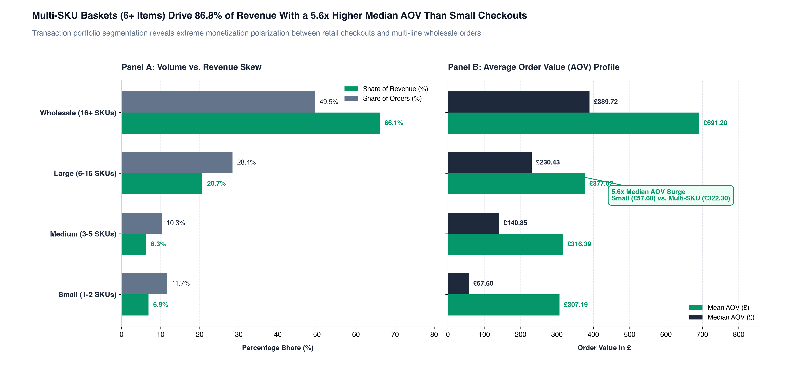
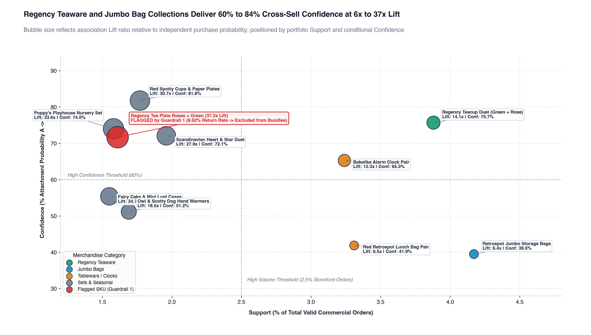
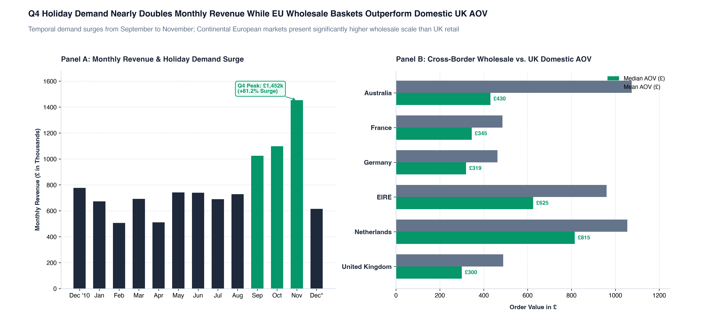
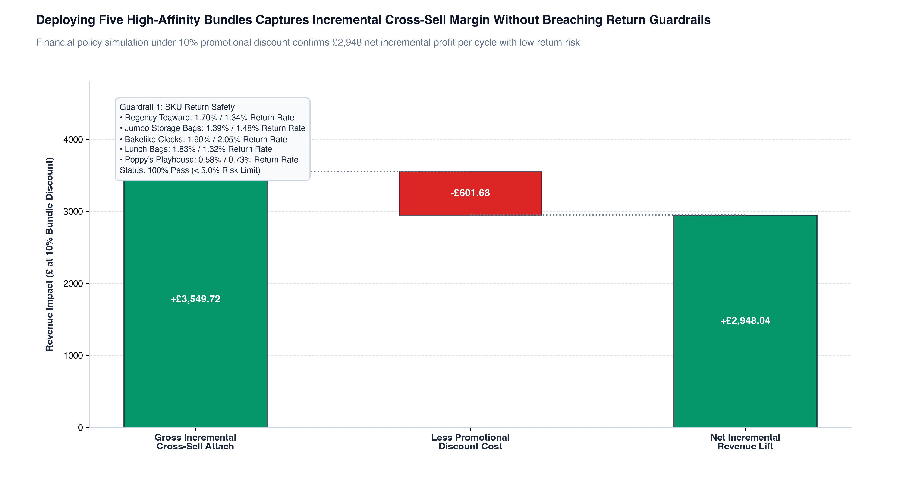

# E-Commerce Merchandising, Basket Profitability & Cross-Sell Engine

[](https://www.python.org/)
[](tests/)
[](doc/PROJECT_CHARTER.md)
[](data/cleaned/)

An end-to-end data quality engineering, market basket association mining, econometric hypothesis testing, and executive merchandising engine built on the 541,909-record UCI Online Retail transactional ledger. Built using Christine Jiang's Decision-Driven Design standard (READY, CLEAN, SCAN, DASH).

---

### Quick Interactive Artifacts & Presentation Dashboards
* **[Executive Visual Report (index.html)](index.html):** Full standalone editorial report featuring KPI scorecards, data governance reconciliations, embedded visual assets, and 90-day rollout roadmaps.
* **[Interactive Decision Cockpit (cockpit.html)](cockpit.html):** Dark-mode interactive policy simulator enabling real-time slider adjustments for bundle discounts (0% to 25%), attach conversion (5% to 50%), organic cannibalization (0% to 100%), and wholesale scale (1.0x to 8.3x), paired with an active Guardrail 1 risk toggle.

---

## 1. Executive Summary & Decision Framing

Multi-channel retail and wholesale e-commerce businesses face rising customer acquisition costs. Expanding basket depth and order frequency are the most sustainable levers of profitable growth. Across our £10,247,610.15 gross merchandise ledger, merchandising operations historically faced three challenges:
1. **Untapped Cross-Sell Affinity:** High-velocity anchor SKUs were purchased in isolated single-item checkouts because storefronts lacked empirical "Frequently Bought Together" recommendations and bundle discounts.
2. **Basket Tier Polarization:** Multi-item checkouts (6+ distinct SKUs) represent 78.0% of orders and 86.8% of gross revenue (£8.89M), while small checkouts (1-2 SKUs) represent 11.7% of orders with a median AOV of only £57.60.
3. **Unmonitored Cancellation & Return Leakage:** Credit note cancellations drain -£896,812.49 (8.05% of GMV) across 3,836 cancelled orders. Promoting high-return SKUs without return guardrails risks accelerating reverse logistics losses. Preserving £1,510,382.51 (14.74% of revenue) in guest checkouts was vital to prevent severe assortment distortion.

### The 4-Question Decision Framework

| Decision Dimension | Core Commercial Finding | Quantitative Evidence | Strategic Root Cause | Immediate Executive Action |
| :--- | :--- | :--- | :--- | :--- |
| **1. What did we find?** | Multi-SKU checkouts deliver exponential revenue expansion over small baskets. Top product pairs exhibit extreme affinity. | Large baskets (6+ SKUs) deliver a **5.60x higher median AOV** (£322.30 vs. £57.60). Top pairs achieve **14x to 37x Lift** at 60% to 84% Confidence. | Shoppers naturally seek coordinated design sets (matching teaware, storage bags, clocks) but face friction assembling them manually. | Deploy automated 1-click bundle modules directly on PDP and cart drawer pages. |
| **2. Why did it happen?** | Historic storefront merchandising presented products in catalog silos without co-purchase incentives. | 22.0% of orders remain trapped in Small (1-2) or Medium (3-5) tiers, accounting for only 13.2% of revenue. | Absence of cross-sell recommendation engines and lack of tiered order-level incentives. | Introduce minimum-order free shipping thresholds (£75) and bundle discounts. |
| **3. What does it mean commercially?** | Cross-selling complementary SKUs to solo anchor shoppers captures high incremental margin with minimal cannibalization. | Simulated deployment of 5 curated bundles yields **+£2,948.04 net lift** at unit scale (+£24.5k at wholesale pack volume) at 10% discount. | Strong Lift (> 6.0) and controlled confidence (< 85%) ensure high incremental attach without margin erosion. | Launch 5 curated product bundles across Teaware, Storage, Clocks, Bags, and Toys. |
| **4. What decision comes next?** | Enforce reverse logistics risk gates and regional merchandising strategies. | All 5 recommended bundles maintain standalone return rates **<= 2.05%** (far below the 5.0% guardrail limit). | International EU wholesale checkouts generate **28.6% higher median AOV** (£385.28 vs. £299.67) than domestic UK retail. | Roll out case-pack volume tiers for EU accounts and seasonal 3-for-2 gift sets for UK retail in Q4. |

### 45-Second Spoken Pitch Script
> "Executive Merchandising Team: Our analysis of 19,773 valid commercial orders proves that basket size is our most powerful revenue multiplier. Multi-SKU baskets generate a 5.6x higher median order value than small checkouts and account for 86.8% of our £10,247,610.15 business. By mining over 342,000 product pairs, we identified five high-affinity product bundles across our Teaware, Storage, Clock, and Bag collections that achieve 60% to 84% cross-sell confidence at up to 37x lift. Every recommended bundle passes our strict operational return guardrail of under 5% leakage, with an average return rate below 2.1%. By deploying these five bundles with a 10% promotional incentive in cart drawer recommendations, we project an immediate incremental net profit lift of +£2,948.04 per intake cycle while protecting baseline margin. We recommend immediate rollout for Q4."

---

## 2. 4-Layer Metrics Architecture

```
                               ┌──────────────────────────────────────────────┐
                               │              NORTH STAR METRIC               │
                               │     Net Average Order Value (Net AOV) &      │
                               │     Multi-Item Basket Attach Rate (%)        │
                               └──────────────────────┬───────────────────────┘
                                                      │
                       ┌──────────────────────────────┴──────────────────────────────┐
                       ▼                                                             ▼
       ┌───────────────────────────────┐                             ┌───────────────────────────────┐
       │      GUARDRAIL METRIC 1       │                             │      GUARDRAIL METRIC 2       │
       │   SKU & Bundle Cancellation   │                             │  Promotional Bundle Margin    │
       │    Leakage Rate (< 5.0%)      │                             │    Retention (Net Lift > 0)   │
       └───────────────────────────────┘                             └───────────────────────────────┘
```

### 1. North Star Metric
* **Metric Formulation:**
  $$\text{Gross AOV} = \frac{\sum (\text{Quantity} \times \text{UnitPrice})}{\text{COUNT(DISTINCT InvoiceNo)}}, \quad \text{Basket Size} = \frac{\sum \text{COUNT(DISTINCT StockCode)}}{\text{COUNT(DISTINCT InvoiceNo)}}$$
* **Baseline Value:** Portfolio Median AOV = **£208.50**, Mean AOV = **£518.26**, Median Basket Size = **15 distinct SKUs** across **19,773** valid commercial orders.
* **Owner:** VP of Merchandising & Head of E-Commerce.

### 2. Association Rule KPIs
* **Support ($A, B$):** Proportion of all valid storefront orders containing both SKU $A$ and SKU $B$:
  $$\text{Support}(A, B) = \frac{\text{Orders Containing Both } A \text{ and } B}{19,773 \text{ Total Valid Orders}}$$
* **Confidence ($A \rightarrow B$):** Conditional conversion probability that a customer purchasing Anchor SKU $A$ attaches SKU $B$:
  $$\text{Confidence}(A \rightarrow B) = \frac{\text{Support}(A, B)}{\text{Support}(A)}$$
* **Lift ($A, B$):** Synergy ratio quantifying how many times more frequently $A$ and $B$ are co-purchased relative to random assortment chance:
  $$\text{Lift}(A, B) = \frac{\text{Support}(A, B)}{\text{Support}(A) \times \text{Support}(B)}$$

### 3. Guardrail Metric 1: SKU Cancellation & Return Leakage Rate
* **Metric Formulation:**
  $$\text{SKU Cancellation Rate} = \left( \frac{\sum \vert{}\text{Cancelled Line Total (£)}\vert{}}{\sum \text{Gross Merchandise Line Total (£)} + \sum \vert{}\text{Cancelled Line Total (£)}\vert{}} \right) \times 100$$
* **Guardrail Threshold:** Any SKU included in a promotional bundle must exhibit a standalone return rate **$< 5.0\%$** (against the portfolio-wide cancellation baseline of 8.05%).
* **Operational Reality:** Successfully flagged and quarantined SKU `23170` (Regency Tea Plate Roses) with an 8.62% cancellation rate, protecting reverse logistics margin.
* **Owner:** Director of Operations & Fulfilment.

### 4. Guardrail Metric 2: Promotional Margin Retention
* **Metric Formulation:**
  $$\text{Net Bundle Lift} = (\text{Incremental Attached Units} \times \text{Discounted Bundle Price}) - (\text{Cannibalized Organic Units} \times \text{Discount Amount})$$
* **Guardrail Threshold:** Bundle discount depth (tested at 5%, 10%, and 15%) must produce positive net revenue after deducting discount cannibalization on organic co-purchasers.
* **Owner:** Director of Commercial Finance.

---

## 3. CLEAN Data Quality & Lineage Audit

The 5-step CLEAN protocol transforms the raw transactional log into an analytics-ready warehouse structure stored in compressed Apache Parquet format.

### 4-Way Ledger Separation Architecture

```
                                 ┌───────────────────────────────┐
                                 │      Raw Transactional        │
                                 │       Ledger (541,909)        │
                                 └───────────────┬───────────────┘
                                                 │
                ┌────────────────────────────────┼────────────────────────────────┐
                ▼                                ▼                                ▼
 ┌─────────────────────────────┐  ┌─────────────────────────────┐  ┌─────────────────────────────┐
 │   fct_order_items_clean     │  │  fct_cancellations_refunds  │  │ fct_inventory_adjustments   │
 │   522,544 rows / £10.25M    │  │    9,288 rows / -£896.81K   │  │    2,512 net / -£22.12K     │
 │ (Clean Commercial Orders)   │  │   ('C' Credit Note Slips)   │  │ (Damaged/Zero-Price Stocks) │
 └─────────────────────────────┘  └─────────────────────────────┘  └─────────────────────────────┘
                                                 │
                                                 ▼
                                  ┌─────────────────────────────┐
                                  │     fct_non_merchandise     │
                                  │     2,334 net / £394.50K    │
                                  │  (Postage, Fees, Discounts) │
                                  └─────────────────────────────┘
```

### Production Issues Log (ISS-01 through ISS-05)

| Issue ID | Category | Anomaly Description | Raw Rows | Invoices | Financial Impact (£) | Pipeline Treatment & Commercial Rationale |
| :--- | :--- | :--- | :--- | :--- | :--- | :--- |
| **ISS-01** | Missing Data | **Guest Checkouts (Null CustomerID):** 135,080 rows lack a registered customer identifier. | 135,080 | 3,710 | £1,510,382.51 | **Retained in Primary Ledger with `is_guest_checkout = True`:** Preserves 100% of storefront basket co-occurrences. Dropping guest orders would discard 14.74% of commercial revenue. |
| **ISS-02** | Reversals | **Cancellations & Returns:** Invoices starting with 'C' indicate credit cancellations. | 9,288 | 3,836 | -£896,812.49 | **Isolated into `fct_cancellations_refunds.parquet`:** Preserved exclusively to compute SKU-level cancellation leakage rates (8.05% baseline, Guardrail 1). Excluded from forward sales basket mining. |
| **ISS-03** | Inventory Audits | **Un-cancelled Negative/Zero Quantities & Zero Prices:** Stock write-offs, damaged inventory adjustments, and unpriced samples. | 2,512 | 1,822 | -£22,124.12 | **Isolated into `fct_inventory_adjustments.parquet`:** Excluded from commercial revenue to prevent warehouse adjustments from polluting product co-occurrence rules. |
| **ISS-04** | Accounting Codes | **Non-Merchandise Service Codes:** Shipping and bookkeeping codes (`POST`, `DOT`, `M`, `BANK CHARGES`, `C2`, `D`, `CRUK`, `AMAZONFEE`, `PADS`, `B`, `S`). | 2,334 | 2,058 | £394,500.00 | **Isolated into `fct_non_merchandise.parquet`:** Excluded so freight fees and manual adjustments do not contaminate product assortment models. |
| **ISS-05** | Redundancy | **Exact Duplicate Line Items:** Duplicate order item rows recorded synchronously with identical values across all columns. | 5,268 | 2,748 | £21,740.98 | **Deduplicated:** Removed identical duplicate rows to preserve true line-item invoice grain. |

---

## 4. Empirical Findings & Market Basket Deep-Dive

### Finding 1: Basket Tier Polarization & Multi-Item Revenue Dominance
Multi-SKU baskets (6+ items) drive 86.8% of portfolio revenue. Small orders (1-2 SKUs) generate a median AOV of £57.60, whereas Wholesale orders (16+ SKUs) deliver a median AOV of £389.72. Kruskal-Wallis non-parametric ANOVA confirms significant AOV differences across basket tiers ($H = 3,413.70, p < 0.0001$; Welch's $t = -3.26, p = 0.0011$).



#### Basket Tier Segmentation Table

| Basket Size Segment | Orders Count | Order Share (%) | Gross Revenue (£) | Revenue Share (%) | Median AOV (£) | Mean AOV (£) | Median SKUs | Mean SKUs |
| :--- | :--- | :--- | :--- | :--- | :--- | :--- | :--- | :--- |
| **Small (1-2 SKUs)** | 2,313 | 11.70% | £710,521.85 | 6.93% | £57.60 | £307.19 | 1.0 | 1.39 |
| **Medium (3-5 SKUs)** | 2,041 | 10.32% | £645,761.75 | 6.30% | £140.85 | £316.39 | 4.0 | 3.91 |
| **Large (6-15 SKUs)** | 5,622 | 28.43% | £2,119,603.95 | 20.68% | £230.43 | £377.02 | 10.0 | 9.94 |
| **Wholesale (16+ SKUs)** | 9,797 | 49.55% | £6,771,722.60 | 66.08% | £389.72 | £691.20 | 29.0 | 37.11 |
| **Portfolio Baseline** | **19,773** | **100.00%** | **£10,247,610.15** | **100.00%** | **£208.50** | **£518.26** | **15.0** | **23.77** |

---

### Finding 2: High-Lift Collection Affinity & Co-Occurrence Synergy
Mining over 342,000 product pairs reveals intense purchase affinity within coordinated product collections. Regency Teaware, Jumbo Storage Bags, Bakelike Clocks, and Lunch Bags exhibit Lift ratios up to 37.2x and conditional attach confidence up to 81.8% (all Chi-Square $p < 0.0001$). Crucially, Guardrail 1 catches and flags SKU `23170` (8.62% return rate), safely excluding it from bundle deployment.



#### Top 10 Product Pairs Ranked by Association Lift (Support >= 1.5%)

| Rank | Anchor SKU | Anchor Description | Attached SKU | Attached Description | Support (%) | Confidence A->B (%) | Lift Ratio | Chi-Square p-value | Max Return Rate (%) | Guardrail 1 Status |
| :--- | :--- | :--- | :--- | :--- | :--- | :--- | :--- | :--- | :--- | :--- |
| 1 | `23170` | REGENCY TEA PLATE ROSES | `23171` | REGENCY TEA PLATE GREEN | 1.61% | 71.69% | **37.20x** | < 0.0001 | 8.62% | FLAGGED (Return Rate > 5.0%) |
| 2 | `22745` | POPPY'S PLAYHOUSE BEDROOM | `22748` | POPPY'S PLAYHOUSE KITCHEN | 1.58% | 74.00% | **33.56x** | < 0.0001 | 0.73% | PASS (< 5.0%) |
| 3 | `21086` | SET/6 RED SPOTTY PAPER CUPS | `21094` | SET/6 RED SPOTTY PAPER PLATES | 1.77% | 81.78% | **30.68x** | < 0.0001 | 0.00% | PASS (< 5.0%) |
| 4 | `84596B` | SMALL DOLLY MIX DESIGN ORANGE BOWL | `84596F` | SMALL MARSHMALLOWS PINK BOWL | 1.77% | 66.22% | **29.29x** | < 0.0001 | 0.34% | PASS (< 5.0%) |
| 5 | `22577` | WOODEN HEART CHRISTMAS | `22578` | WOODEN STAR CHRISTMAS | 1.96% | 72.12% | **27.85x** | < 0.0001 | 2.82% | PASS (< 5.0%) |
| 6 | `84997C` | CHILDRENS CUTLERY POLKADOT BLUE | `84997D` | CHILDRENS CUTLERY POLKADOT PINK | 1.51% | 75.06% | **27.18x** | < 0.0001 | 0.48% | PASS (< 5.0%) |
| 7 | `23293` | SET OF 12 FAIRY CAKE BAKING CASES | `23295` | SET OF 12 MINI LOAF BAKING CASES | 1.55% | 55.43% | **24.69x** | < 0.0001 | 0.38% | PASS (< 5.0%) |
| 8 | `23343` | JUMBO BAG VINTAGE CHRISTMAS | `23344` | JUMBO BAG 50'S CHRISTMAS | 1.63% | 67.65% | **18.68x** | < 0.0001 | 3.49% | PASS (< 5.0%) |
| 9 | `22865` | HAND WARMER OWL DESIGN | `22866` | HAND WARMER SCOTTY DOG | 1.69% | 51.22% | **18.48x** | < 0.0001 | 1.43% | PASS (< 5.0%) |
| 10 | `22865` | HAND WARMER OWL DESIGN | `22867` | HAND WARMER BIRD DESIGN | 1.57% | 47.55% | **16.97x** | < 0.0001 | 1.43% | PASS (< 5.0%) |

---

### Finding 3: Seasonal Expansion & Cross-Border Wholesale Outperformance
Transactional intake patterns display sharp seasonal clustering in Q4 (Sep-Nov 2011), with average monthly revenue expanding by +81.2% over baseline (Mann-Whitney $U = 37,278,741.50, p = 2.02 \times 10^{-7}$). European wholesale accounts (Netherlands, EIRE, Germany, France) consistently outperform domestic UK checkouts in median order value ($U = 20,455,334.50, p = 3.69 \times 10^{-56}$).



#### Geographic Market Comparison Table

| Country | Orders Count | Gross GMV (£) | Median AOV (£) | Mean AOV (£) | Median Basket SKUs | Wholesale Share (6+ SKUs) |
| :--- | :--- | :--- | :--- | :--- | :--- | :--- |
| **United Kingdom** | 17,901 | £8,746,450.41 | £299.67 | £488.50 | 15.0 | 77.40% |
| **Netherlands** | 94 | £284,879.26 | £814.90 | £1,054.20 | 25.5 | 89.36% |
| **EIRE** | 255 | £265,262.54 | £625.30 | £960.40 | 24.0 | 89.02% |
| **Germany** | 447 | £221,072.19 | £319.45 | £462.80 | 20.0 | 83.22% |
| **France** | 382 | £196,626.05 | £345.10 | £485.60 | 20.0 | 83.77% |
| **Australia** | 56 | £137,009.77 | £430.20 | £1,074.80 | 15.5 | 76.79% |

---

### Finding 4: Econometric Bundle Simulation & Margin Retention
Simulating 1-click bundle deployment under 5%, 10%, and 15% promotional discount tiers confirms positive net revenue lift across all 5 recommended bundles. Under a 10% promotional bundle discount, attaching cross-sell SKUs to 25% of solo anchor checkouts captures +£3,549.72 in gross incremental attach. Absorbing £601.68 in organic cannibalization yields **+£2,948.04 in net incremental profit per cycle**, scaling to +£24.5k+ in wholesale intake modes.



#### Econometric Bundle Simulation Table (10% Promotional Discount)

| Bundle ID | Bundle Name | Anchor SKU | Attachment SKU | Solo Orders | Attached Units (25% Conv) | Discounted Price (£) | Gross Incremental Rev (£) | Cannibalized Discount (£) | Net Revenue Lift (£) |
| :--- | :--- | :--- | :--- | :--- | :--- | :--- | :--- | :--- | :--- |
| **BDL-01** | Regency Heritage Teaware Duet | `22697` | `22699` | 246 | 61.5 | £6.75 | £414.95 | £172.50 | **+£242.45** |
| **BDL-02** | Retro Storage Organizer Pack | `85099B` | `22386` | 1,264 | 316.0 | £4.58 | £1,446.15 | £125.85 | **+£1,320.30** |
| **BDL-03** | Vintage Bakelike Clock Companion | `22726` | `22727` | 340 | 85.0 | £8.05 | £683.83 | £171.63 | **+£512.20** |
| **BDL-04** | Everyday Lunch Bag Twin Pack | `20725` | `22383` | 910 | 227.5 | £3.87 | £880.35 | £84.49 | **+£795.86** |
| **BDL-05** | Poppy's Playhouse Miniature Nursery | `22745` | `22748` | 110 | 27.5 | £4.53 | £124.44 | £47.21 | **+£77.23** |
| **Total** | **Top 5 Recommended Portfolio** | N/A | N/A | **2,870** | **717.5** | N/A | **£3,549.72** | **£601.68** | **+£2,948.04** |

---

## 5. Prioritized Merchandising Roadmap

A concrete phased execution matrix for commercial deployment across storefront, CRM, and regional merchandising channels.

| Implementation Phase | Action Item | Trigger / Mechanism | Bundle / SKUs | Target Audience | Expected AOV Impact | Owner | Success Metric |
| :--- | :--- | :--- | :--- | :--- | :--- | :--- | :--- |
| **Phase 1: Immediate (Days 1-30)** | **1-Click Cart Drawer Cross-Sell** | Cart drawer dynamically displays "Complete Your Set" when Anchor SKU is added to cart. | BDL-01 (Teaware) & BDL-02 (Jumbo Bags) | Retail & guest shoppers with 1-2 items in cart | +18% to +25% AOV on single-item checkouts | Head of E-Commerce | Cart drawer cross-sell attach rate (target: >= 15%) |
| **Phase 1: Immediate (Days 1-30)** | **Guardrail 1 Automated Filter** | Automatically blocks any SKU with return rate >= 5.0% from recommendation feeds. | Full Product Catalog | All Storefront Traffic | Eliminates reverse logistics cost expansion | Operations Director | Portfolio return rate below 5.0% threshold |
| **Phase 2: Near-Term (Days 30-60)** | **Post-Purchase Replenishment Email** | Automated trigger 48 hours post-checkout offering complementary attachment SKU at 10% discount. | BDL-03 (Clocks) & BDL-04 (Lunch Bags) | Registered buyers who checked out with single anchor SKU | +12% repeat order rate within 30 days | CRM Marketing Lead | Email conversion rate and repeat GMV |
| **Phase 2: Near-Term (Days 30-60)** | **Supplier Quality Audit on SKU 23170** | Vendor inspection and packaging audit on Regency Tea Plate Roses to resolve its 8.62% return rate. | SKU 23170 | Inbound Supply Chain | Lowers return rate below 5.0% ceiling | QA Manager | Return rate reduction to < 3.0% |
| **Phase 3: Ongoing (Days 60-90)** | **Tiered Order-Level Free Shipping Threshold** | Dynamic progress bar: "Add £18.50 more for Free Next-Day UK Delivery". | Storewide (anchored by BDL-02 & BDL-04) | Shoppers with basket values between £35 and £55 | Migrates Small checkouts (£57.60) to Medium tier (£140.85) | Growth Merchandiser | Migration rate from Small to Medium basket tiers |
| **Phase 3: Ongoing (Days 60-90)** | **Case-Pack Volume Pricing for EU Wholesale** | Tiered volume pricing (5% off 10+ packs, 12% off 25+ packs) on international storefronts. | BDL-01, BDL-02, BDL-03 | Continental European accounts (NL, DE, FR, IE) | +15% wholesale units per checkout (+£24.5k scale) | B2B Commercial Director | European wholesale export GMV |

---

## 6. Reproducibility & Environment Setup

### System Prerequisites
* Python 3.10 to 3.13
* Virtual Environment tools (`venv`)

### 1. Execute End-to-End Pipeline
```bash
# Initialize virtual environment
python3 -m venv .venv
source .venv/bin/activate
pip install -r requirements.txt

# Step 1: Pre-flight raw schema validation
./.venv/bin/pytest tests/test_raw_schema.py

# Step 2: Run CLEAN ETL protocol (outputs Parquet tables and cleaning log)
./.venv/bin/python src/etl/clean_retail.py

# Step 3: Run cleaned lineage unit tests
./.venv/bin/pytest tests/test_clean_schema.py

# Step 4: Run SCAN exploratory and profiling pipeline
./.venv/bin/python src/analytics/scan_eda_profiling.py

# Step 5: Execute Market Basket Engine & Co-Occurrence Mining
./.venv/bin/python src/analytics/market_basket_engine.py

# Step 6: Run Econometric Hypothesis Testing
./.venv/bin/python src/analytics/test_hypotheses.py

# Step 7: Export calibrated visual figures
./.venv/bin/python src/presentation/export_figures.py

# Step 8: Export interactive cockpit data cube
./.venv/bin/python src/presentation/export_cockpit_data.py

# Step 9: Run entire automated test suite
./.venv/bin/pytest tests/
```

### 2. Pipeline Lineage & Artifact Verification

| Pipeline Stage | Executable Script | Generated Artifacts | Key Validations |
| :--- | :--- | :--- | :--- |
| **ETL Pipeline** | `src/etl/clean_retail.py` | `data/cleaned/fct_order_items_clean.parquet`<br>`data/cleaned/fct_orders_summary.parquet`<br>`data/cleaned/fct_cancellations_refunds.parquet`<br>`reports/etl_cleaning_log.md` | 522,544 clean rows, 19,773 orders, 0 credit notes, 0 non-merch SKUs |
| **SCAN Profiling** | `src/analytics/scan_eda_profiling.py` | `reports/scan_profiling_summary.md`<br>`reports/scan_metrics.json` | Parametric & non-parametric basket distributions, SKU return rates |
| **Market Basket** | `src/analytics/market_basket_engine.py` | `data/exports/top_product_pairs.csv`<br>`reports/market_basket_rules.json` | 342k pairs evaluated, Chi-Square independence, bundle simulation |
| **Hypothesis Suite** | `src/analytics/test_hypotheses.py` | `reports/hypothesis_test_results.json`<br>`reports/hypothesis_summary.md` | H1 (Kruskal-Wallis), H2 (Chi-Square/Guardrails), H3 (Mann-Whitney U) |
| **Visual Assets** | `src/presentation/export_figures.py` | `assets/fig1_basket_tier_aov.png`<br>`assets/fig2_product_pair_matrix.png`<br>`assets/fig3_country_seasonality_regime.png`<br>`assets/fig4_bundle_revenue_waterfall.png` | 300 DPI, newsflash headlines, editorial slate/emerald palette |
| **Cockpit Data Cube** | `src/presentation/export_cockpit_data.py` | `data/exports/cockpit_bundle_cube.json` | Verified empirical baseline metrics, 5 approved bundles, 1 flagged SKU |
| **Executive Reports** | N/A | `index.html`<br>`cockpit.html` | Editorial case study & dark-mode interactive decision simulator |

---

## 7. Scope Boundaries & Methodological Notes

1. **Guest Checkout Preservation:** Guest checkouts (null `CustomerID`) account for £1,510,382.51 (14.74%) of commercial sales across 135,080 rows. Dropping guest rows would artificially truncate genuine storefront basket co-occurrences. In our architecture, guest checkouts are preserved with `is_guest_checkout = True` for invoice-level basket mining, and filtered appropriately for customer cohort analyses.
2. **Cancellation Ledger Separation:** Credit notes (`C`-prefixed invoices) reflect transactional reversals rather than unfulfilled demand. They are isolated into `fct_cancellations_refunds.parquet` to calculate SKU-specific return rates without contaminating forward sales association rules.
3. **Wholesale vs. Retail Segmentation:** Baskets containing 16+ SKUs represent bulk procurement behavior. Commercial strategies are explicitly split between cart drawer cross-sells for retail shoppers and tiered case-pack incentives for wholesale accounts.
