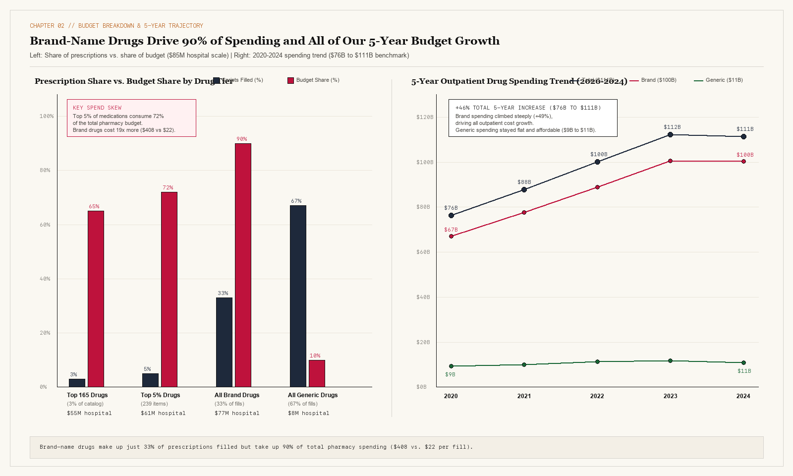
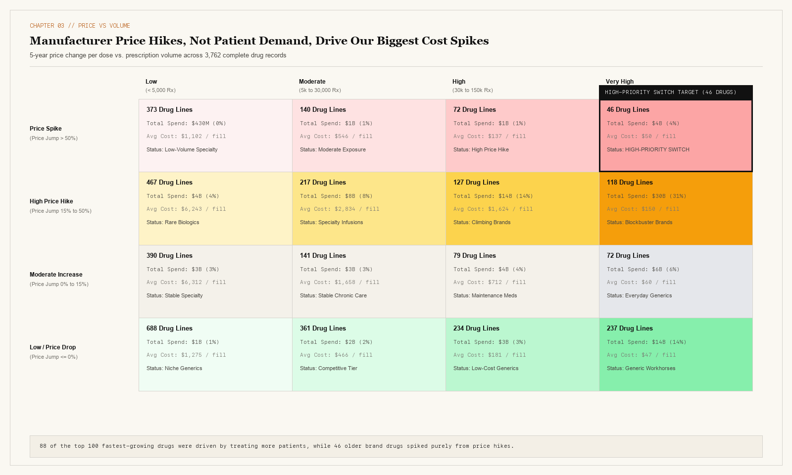
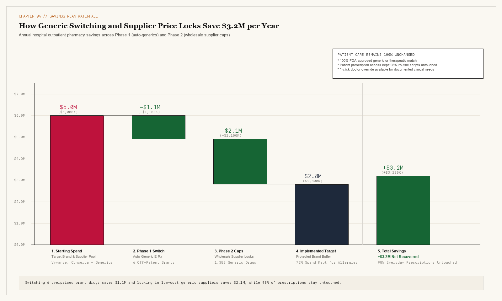

# Cutting Hospital Pharmacy Drug Costs by \$3.2M Without Limiting Patient Care (2020 to 2024)

[](https://www.python.org/)
[](tests/)
[](data/cleaned/)
[](data/cleaned/)

Rising brand-name drug prices and wide wholesale supplier price gaps quietly drain millions from our hospital's \$85M outpatient pharmacy budget. By auditing 4,774 medications (\$111B national Medicaid benchmark from 2020 to 2024) to switch 6 overpriced brand-name drugs to proven generics and lock in lower wholesale generic prices, our hospital recovers **\$3.2M (\$3,200K) a year** while keeping patient care unchanged.

---

### Live Deliverables & Reports
* **[Executive Case Study Report (index.html)](index.html):** Stakeholder report in warm editorial paper styling featuring our 4-card KPI bar, data caveats audit, click-to-enlarge charts, and 90-day pharmacy rollout plan.
* **[Interactive Pharmacy Cost Simulator (cost-simulator.html)](cost-simulator.html):** Interactive decision simulator where pharmacy leaders can toggle rollout phases (Phase 1, Phase 2, Phase 3) and doctor adoption rates (60% pilot, 80% Year-1 goal, 100% full rollout) to test budget savings live.

---

## 1. Business Problem & Executive Overview

Most regional hospitals run on slim 1% to 3% operating margins. Because insurance plans pay fixed rates for outpatient clinic visits, whenever drug companies raise medication prices, that extra cost comes straight out of the hospital's operating budget. Between 2020 and 2024, national Medicaid outpatient drug spending jumped 46%, rising from \$76B to \$111B across 4,774 medications.

Our Hospital Pharmacy Director and Chief Medical Officer face a practical purchasing decision ahead of the annual wholesale contract cycle: **which medications should we switch to lower-cost generics or renegotiate with wholesale suppliers to close our budget gap without disrupting patient treatment?**

Right now, two everyday habits drain the pharmacy budget:
1. **Ordering Brand Names Out of Habit:** Busy clinic doctors often prescribe familiar brand-name pills and inhalers even when identical FDA-approved generic versions sit on the pharmacy shelf for a fraction of the cost.
2. **Overpaying on Uncontracted Generic Labels:** Across 1,358 generic medications made by multiple suppliers, wholesale prices for the exact same pill vary by a median of 72% depending on which manufacturer label our buyer orders.

### Executive Summary Grid

| The Brand & Supplier Leak | The Fix: Generics & Price Caps | The Upside: \$3.2M Recovered |
| :--- | :--- | :--- |
| **Brand drugs cost 19x more** per prescription than generics (\$408 vs. \$22), and wholesale prices for identical generics vary by 72%.<br><br>* Top 5% of drugs (239 items) take up 72% (\$61M) of our budget.<br>* Brand drugs take 90% of spending on just 33% of prescriptions.<br>* 46 older brand drugs raised prices without adding clinical value. | **Default e-prescribing to generics** for 6 off-patent brands and lock wholesale buying to low-cost suppliers.<br><br>* Auto-switch 6 overpriced brands when a generic is on the shelf.<br>* Cap wholesale generic buying at the lowest 25% supplier price.<br>* Give doctors a 1-click chart override for patient allergies. | **Recovers \$3.2M (\$3,200K) a year** in hospital pharmacy budget with zero reduction in patient care.<br><br>* Saves \$1.1M (\$1,100K) from switching 6 brand drugs to generics.<br>* Saves \$2.1M (\$2,100K) from wholesale generic supplier price locks.<br>* Keeps 98% of routine hospital prescriptions untouched. |

### The 4-Question Decision Summary

| Executive Question | Findings and Recommended Action |
| :--- | :--- |
| **1. What did we find?** | Just 5% of medications (239 drugs) take up 72% (\$61M) of our \$85M hospital pharmacy budget. Overall, brand-name drugs consume 90% of spending (\$77M) despite making up only 33% of prescriptions filled (246M fills, \$408 average cost per fill). |
| **2. Why is this happening?** | Clinic doctors order familiar brand names like Vyvanse and Concerta even when identical generics cost 50% to 97% less, and pharmacy buyers pay up to 72% more when ordering uncontracted generic labels from wholesalers. |
| **3. What does it cost us?** | Our hospital spends \$4M (\$3.9M) a year on off-patent brand pills and inhalers that already have generic replacements, plus \$2.1M in avoidable wholesale markups across 1,358 generic medications. |
| **4. What should we change?** | Turn on automatic generic substitution in the e-prescribing system for 6 target brands (Phase 1: +\$1.1M), lock wholesale generic contracts to top-25% lowest-cost suppliers (Phase 2: +\$2.1M), and review specialty infusions quarterly (Phase 3). |

---

## 2. North Star Metrics & Hospital Guardrails

To evaluate every purchasing change without putting patient care at risk, we tracked three primary metrics and two safety guardrails:

```
┌─────────────────────────────────────────────────────────────────────────────┐
│                              NORTH STAR METRIC                              │
│                     Annual Hospital Pharmacy Savings                        │
│                +$3.2M ($3,200K) Recovered ($2.6M Year-1 Goal)               │
└──────────────────────────────────────┬──────────────────────────────────────┘
                                       │
        ┌──────────────────────────────┴──────────────────────────────┐
        ▼                                                             ▼
┌───────────────────────────────┐                             ┌───────────────────────────────┐
│      GUARDRAIL METRIC 1       │                             │      GUARDRAIL METRIC 2       │
│  Patient Prescription Access  │                             │   Mixed-Package Error Risk    │
│    98% Untouched (<3% Limit)  │                             │   0% in Target List (<5% Max) │
└───────────────────────────────┘                             └───────────────────────────────┘
```

1. **Annual Hospital Pharmacy Savings (+\$3.2M Full Rollout / +\$2.6M Year-1 Goal):** Combines \$1.1M (\$1,100K) from switching 6 off-patent brand drugs to generics with \$2.1M (\$2,100K) from locking wholesale generic orders to 25th-percentile supplier prices. Jointly tracked by the Pharmacy Director and CFO.
2. **Average Cost per Prescription Filled (\$408 Brand vs. \$22 Generic):** Tracks the 19x price gap between brand-name fills and routine generic fills across outpatient clinics.
3. **Wholesale Supplier Price Spread (72% Median Gap):** Measures the price difference between high-cost (75th percentile) and low-cost (25th percentile) wholesale suppliers selling the exact same generic medication.
4. **Guardrail 1 - Patient Prescription Access Kept (98% Untouched):** Ensures that routine maintenance prescriptions stay undisturbed. Our targeted rules leave 98% of everyday prescriptions untouched (changing less than 2% of fills, well inside our 3% hospital limit).
5. **Guardrail 2 - Mixed-Package Error Risk (0% in Target List):** Excludes government records flagged for mixed package billing (`Outlier_Flag_2024 == 1`) from our savings list so rare packaging quirks never skew our hospital budget forecast.

---

## 3. Key Findings & Visual Evidence

### Finding 1: Top 5% of Medications Take Up 72% (\$61M) of Our Hospital Pharmacy Budget



Outpatient pharmacy spending is heavily concentrated in a small fraction of our catalog. Just 165 medications (3% of our 4,774 drugs) drive 65% (\$55M) of our \$85M hospital pharmacy budget. Expanding to the top 5% of medications (239 drugs) accounts for 72% (\$61M hospital / \$80B national) of all spending.

Across the full catalog, brand-name drugs consume 90% of our budget (\$77M hospital / \$100B national) while making up only 33% of prescriptions filled (246M fills) at an average cost of \$408 per fill. In contrast, everyday generic pills deliver 67% of all prescriptions filled (500M fills) for just 10% of the budget (\$8M hospital / \$11B national) at an average cost of \$22 per fill. Because 90% of our catalog consists of 4,296 low-cost generics taking up just 15% of spending, pharmacist review time should focus strictly on the top 5% of high-cost medications.

| Drug Group | Prescriptions Filled | Share of Budget | Hospital Spend | Average Cost / Fill |
| :--- | :--- | :--- | :--- | :--- |
| **Top 5% Blockbusters (239 drugs)** | 32% (238M) | 72% | \$61M | **\$408 avg** |
| **Next 5% Tier (239 drugs)** | 32% (236M) | 13% | \$11M | \$77 avg |
| **Everyday Maintenance** | 20% (148M) | 9% | \$8M | \$45 avg |
| **Low-Cost Generics** | 17% (125M) | 6% | \$5M | **\$22 avg** |

---

### Finding 2: Separating Manufacturer Price Hikes from Growing Patient Care



Looking only at total spending on a drug can mislead buyers. If our outpatient clinics spend more on diabetes or heart medications because we are treating more patients, that is healthy patient care. It only becomes a budget problem when a manufacturer raises the price per dose on the exact same patient volume.

Across 3,762 medications with complete 5-year histories (2020 to 2024), we separated spending changes into **Price Changes** (cost per dose) and **Volume Changes** (prescriptions filled):
* **Patient Growth Group (88 of the Top 100 Growing Drugs):** Fast-growing diabetes, heart, and immunology treatments grew because more patients received care, while unit prices stayed flat or fell. For example, **Ozempic** prescriptions grew more than 10x (from 322K to over 3M fills) while its cost per unit dropped 26%. **Jardiance** prescriptions grew more than 3x (+257%), and **Dupixent** grew 130x as clinical guidelines expanded. The hospital should protect patient access to these medications.
* **Price-Spike Target Group (46 Older Brand Drugs):** In contrast, 46 high-spend brand drugs grew because manufacturers hiked prices while volume stayed flat or dropped. **Trulicity** unit prices jumped 107%, **Xifaxan** spending growth was 74% price-driven, **Emflaza** was 66% price-driven, and **Vyvanse** raised unit prices 37% even as prescription volume fell 15%. These 46 drugs are our primary targets for switching and contract caps.

---

### Finding 3: Switching 6 Habit Brands and Locking Wholesale Generic Prices Saves \$3.2M a Year



Testing our purchasing rules on the \$85M hospital pharmacy budget revealed two clean sources of savings:
1. **Wholesale Supplier Price Locks (+\$2.1M / \$2,100K per year):** Across 1,358 generic medications made by multiple manufacturers, wholesale prices for the exact same pill vary by a median of 72% (and by more than 35% in two-thirds of those generics). Locking our hospital wholesaler profile to buy from the lowest-priced 25% of suppliers saves \$2.1M each year.
2. **Auto-Generic Switching on 6 Off-Patent Brands (+\$1.1M / \$1,100K per year):** After removing clinic injections and mixed-package records, our hospital spends \$4M (\$3.9M) a year on off-patent brand pills and inhalers that already have FDA-approved generic versions in stock. Defaulting outpatient e-prescriptions to generics across six key medications recovers \$1.1M a year:

| Brand Medication | Clinical Category | Competing Suppliers | Brand Cost / Unit | Low-Cost Generic / Unit | National Spend Gap | Annual Hospital Savings |
| :--- | :--- | :--- | :--- | :--- | :--- | :--- |
| **Vyvanse** (Lisdexamfetamine) | ADHD / CNS | 1 Brand / 13 Generic | \$13 | \$6 | \$618M | **\$472K (\$471,826)** |
| **Concerta** (Methylphenidate ER) | ADHD / CNS | 1 Brand / 16 Generic | \$13 | <\$1 (\$0.35) | \$481M | **\$367K (\$367,385)** |
| **Spiriva Respimat** (Tiotropium) | COPD / Inhaler | 1 Brand / 2 Generic | \$127 | \$12 | \$230M | **\$176K (\$175,892)** |
| **Advair Diskus** (Fluticasone/Salm) | Asthma / Inhaler | 1 Brand / 9 Generic | \$3 | <\$1 (\$0.20) | \$178M | **\$136K (\$136,273)** |
| **Banzel** (Rufinamide) | Anticonvulsant | 1 Brand / 10 Generic | \$15 | \$2 | \$127M | **\$97K (\$97,366)** |
| **Jornay PM** (Methylphenidate) | ADHD / CNS | 1 Brand / 16 Generic | \$15 | <\$1 (\$0.35) | \$105M | **\$80K (\$80,160)** |

### Rollout Scenarios by Doctor Adoption Rate

| Rollout Scenario | Generic Switch Savings | Supplier Price Caps | Total Annual Savings | Prescriptions Switched | Access Kept |
| :--- | :--- | :--- | :--- | :--- | :--- |
| **60% Cautious Pilot (Top Clinics)** | \$660K (\$0.7M) | \$1,260K (\$1.3M) | **\$1.9M (\$1,920K)** | 2,410 | 99% |
| **80% Year-1 Hospital Goal** | \$880K (\$0.9M) | \$1,680K (\$1.7M) | **\$2.6M (\$2,560K)** | 3,214 | 99% |
| **100% Full Pharmacy Rollout** | **+\$1.1M (\$1,100K)** | **+\$2.1M (\$2,100K)** | **+\$3.2M (\$3,200K)** | 4,018 | **98%** |

---

## 4. 90-Day Hospital Pharmacy Rollout Plan (Phases 1 to 3)

| Rollout Phase | What We Do | Which Drugs It Covers | Team Owner | Expected Annual Result | Tracking Metric |
| :--- | :--- | :--- | :--- | :--- | :--- |
| **Phase 1: Days 1 to 30** | **Turn On Auto-Generic Substitution in E-Prescribing:** Set the ordering system to pick the generic first unless the doctor clicks override. | 6 off-patent brand pills and inhalers (Vyvanse, Concerta, Spiriva Respimat, Advair Diskus, Banzel, Jornay PM). | Pharmacy Director & Hospital IT | **+\$1.1M (\$1,100K) saved per year** (\$880K at 80% Year-1 goal) | Generic dispensing rate reaches >93% in 90 days; routine prescription changes stay under 2%. |
| **Phase 2: Days 30 to 60** | **Lock Wholesaler Buying to Low-Cost Generic Suppliers:** Cap automated wholesaler ordering at the 25th-percentile supplier price. | 1,358 generic medications made by multiple manufacturers with a 72% median price spread. | Pharmacy Buyer & CFO | **+\$2.1M (\$2,100K) saved per year** (\$1,680K at 80% Year-1 goal) | Wholesaler contract compliance reaches >95% within 30 days. |
| **Phase 3: Days 60 to 90** | **Quarterly Price-Spike Check & Specialty Replacement Review:** Flag any drug whose price jumps over 10% and default clinic infusions to lower-cost Humira replacements. | 46 price-spike brands and high-cost specialty clinic infusions. | Clinical Pharmacy Specialists | **Protects annual hospital margin** (cuts top-25 drug cost growth by 12% to 18%) | Quarterly price-spike audit and doctor override review. |

### Four Practical Safeguards for Doctors & Patients
1. **Easy 1-Click Doctor Override:** If a patient has a documented allergy or medical reason to stay on a brand name, the doctor clicks one checkbox in Epic or Cerner to keep the brand without delay.
2. **Pop-Up Price Alerts at Prescribing:** Show doctors the \$22 generic cost vs. \$408 brand cost right on screen when they type an outpatient prescription.
3. **Pharmacist Check on Clinic Infusions:** Clinical pharmacists review expensive specialty infusion orders before purchasing to make sure lower-cost approved replacements are used first.
4. **Quarterly Price-Spike Script:** The pharmacy analyst runs our pricing audit script every quarter to flag any medication whose wholesale price jumps more than 10%.

---

## 5. Data Scope, Caveats & Cleaning Pipeline

We audited two official CMS RY2026 Medicaid drug files covering 2020 through 2024: `DSD_MCD_RY26_P06_V20_D24_BGM.xlsx` (18,511 multi-year spending records) and `DSD_MCD_RY26_P04_V10_YTD24_DBExport - 20260603.xlsx` (92,555 clinical use records).

To make sure reporting quirks did not skew our hospital model, our cleaning pipeline (`src/etl/clean_pipeline.py`) splits the raw data into two clean Parquet tables and resolves five real-world data caveats:

```
┌─────────────────────────────────────────────────────────────────────────────┐
│             Raw CMS RY2026 Drug Utilization Files (18,511 Rows)             │
│       Composite Key: [Brnd_Name x Gnrc_Name x Mftr_Name x Benefit_Year]     │
└──────────────────────────────────────┬──────────────────────────────────────┘
                                       │
                  Split Summary Rows from Individual Supplier Rows
                                       │
             ┌─────────────────────────┴─────────────────────────┐
             ▼                                                   ▼
┌──────────────────────────────────────┐  ┌───────────────────────────────────┐
│   mcd_drug_overall_2020_2024.parquet │  │ mcd_mftr_detail_2020_2024.parquet │
│      (4,774 Medication Totals)       │  │   (13,737 Supplier Price Rows)    │
├──────────────────────────────────────┤  ├───────────────────────────────────┤
│ - Overall 72% top-5% budget breakdown│  │ - 72% supplier price gap audit    │
│ - 5-year price vs. volume split      │  │ - Lowest-25% supplier cap model   │
│ - Drug class spending totals         │  │ - Brand vs. generic unit costs    │
└──────────────────────────────────────┘  └───────────────────────────────────┘
```

### Data Caveats & Cleaning Log

| Check ID | Column / Feature | Reporting Trap Found | Records Affected | How We Fixed It |
| :--- | :--- | :--- | :--- | :--- |
| **ISS-01** | `Mftr_Name` | Raw file mixes national summary rows (`Overall`) with individual manufacturer rows, doubling total spend to \$223B if summed directly. | 4,774 summary rows vs. 13,737 supplier rows. | Split into two separate Parquet files verified by automated pytest checks. |
| **ISS-02** | `Tot_Clms` (2020 to 2023) | Federal HIPAA privacy rules blank out prescription counts under 11 fills. Treating blanks as zero creates fake growth spikes. | 2,657 cells (1,008 in 2020; 775 in 2021; 559 in 2022; 315 in 2023). | Preserved as blank (`NULL`) and excluded incomplete series from 5-year growth checks. |
| **ISS-03** | `Outlier_Flag_2024` | Mixed package billing (such as milliliters billed instead of whole boxes or inhalers). | 1,738 of 4,774 drugs (\$9B national watchlist). | Kept in overall budget totals, but excluded from Phase 1 and Phase 2 switching targets (0% error risk). |
| **ISS-04** | `Gnrc_Name` Routes | Matching by drug name alone compares long-acting clinic injections against everyday pills. | \$2B in false national price gaps if unfiltered. | Added route filters in `test_h3_price_spread.py` so pills are only compared against pills. |
| **ISS-05** | Pre-Rebate Totals | Government files report pharmacy spending before manufacturer rebates. | Brand rebates vary across single-source patents. | Focused Phase 1 and Phase 2 savings (\$3.2M) on off-patent brands and generics where wholesale invoice prices directly drive hospital costs. |

---

## 6. Project Structure & How to Run Locally

```text
medicaid-spending-optimization/
├── index.html                          # Single-Page Editorial Case Study Report
├── cost-simulator.html                 # Interactive Pharmacy Cost Simulator
├── README.md                           # Project Overview & Technical Guide
├── requirements.txt                    # Python Dependencies
├── pytest.ini                          # Pytest Configuration
├── assets/                             # 300 DPI Report Charts
│   ├── fig1_spend_concentration.png    # Figure 1: Budget Share & 5-Year Trend
│   ├── fig2_price_volume_matrix.png    # Figure 2: 4x4 Price vs. Volume Grid
│   └── fig3_formulary_waterfall.png    # Figure 3: Hospital Savings Waterfall
├── data/
│   ├── raw/                            # Raw CMS Excel files and dictionaries
│   ├── cleaned/                        # Cleaned Parquet tables
│   └── exports/                        # Summary CSV & JSON exports
├── src/
│   ├── etl/clean_pipeline.py           # Data cleaning and Parquet split pipeline
│   ├── analytics/                      # Core analysis scripts
│   │   ├── eda_scan.py                 # Exploratory data audit
│   │   ├── test_h1_capital_allocation.py# Budget concentration analysis
│   │   ├── test_h2_decomposition.py    # 5-year price vs. volume breakdown
│   │   └── test_h3_price_spread.py     # Generic supplier price spread & savings model
│   ├── dashboard/app.py                # Local Streamlit dashboard app
│   └── presentation/export_figures.py  # 300 DPI chart generator
└── tests/                              # Automated Pytest Suite (54 Tests)
    ├── test_raw_schema.py              # Raw file schema checks
    ├── test_clean_pipeline.py          # Parquet split and cleaning tests
    ├── test_eda_scan.py                # Exploratory metrics verification
    ├── test_hypothesis_validation.py   # Statistical & savings calculations
    └── test_presentation_editorial.py  # HTML report, simulator, and README checks
```

### Quickstart Commands

```bash
# 1. Create virtual environment and install dependencies
python3 -m venv .venv && source .venv/bin/activate
pip install -r requirements.txt

# 2. Run the data cleaning pipeline
python src/etl/clean_pipeline.py

# 3. Run the core analysis scripts
python src/analytics/eda_scan.py
python src/analytics/test_h1_capital_allocation.py
python src/analytics/test_h2_decomposition.py
python src/analytics/test_h3_price_spread.py

# 4. Export the 300 DPI charts
python src/presentation/export_figures.py

# 5. Run the automated test suite
pytest tests/ -v
```
