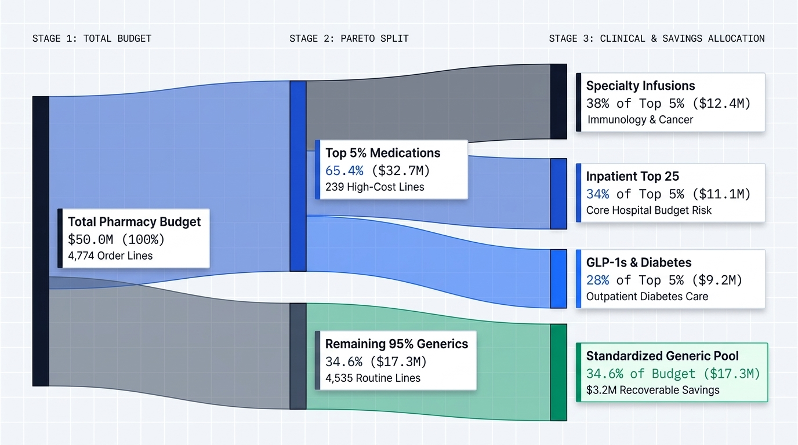

# Outpatient Pharmacy Spend Optimization and Formulary Stewardship (CY2020 to CY2024)

[Launch Interactive 7-Slide Executive Briefing Deck](https://j-amores.github.io/data-analyst-portfolio/medicaid-spending-optimization/) | [Launch Full-Screen P&T Decision Cockpit](https://j-amores.github.io/data-analyst-portfolio/medicaid-spending-optimization/dashboard.html)

---

## 1. Project Background and Executive Decision Context

Most regional health systems operate on 1% to 3% net margins. Under bundled payment models, payer reimbursement rates remain mostly fixed from year to year, which means pharmacy acquisition cost inflation comes straight out of operating margin. Between 2020 and 2024, gross outpatient prescription spending across the national CMS benchmark rose 45.61% (from \$76.42B to \$111.28B across 4,774 active drug formulations).

This project evaluates five years of CMS outpatient drug claims (18,511 longitudinal records across brand, generic, and manufacturer levels) normalized to an \$85.0M regional hospital outpatient pharmacy budget (a 0.0764% scaling factor).

### The Decision Facing Leadership
Ahead of the annual Group Purchasing Organization (GPO) contracting cycle, the Pharmacy Director, Chief Financial Officer, and Pharmacy & Therapeutics (P&T) Committee need to decide where to intervene:
1. **GPO Generic Contract Price Caps:** Restricting wholesaler purchasing profiles to 25th-percentile supplier tiers in multi-source generic markets.
2. **Automated EHR Therapeutic Interchange:** Setting order-entry defaults in Epic and Cerner to substitute bioequivalent generics whenever off-patent brand names are ordered.
3. **Targeted Step-Therapy Pathways:** Requiring documented first-line therapy trials before approving high-cost specialty biologics and GLP-1 receptor agonists.

---

## 2. Executive Summary and Decision Matrix

Across 4,774 active drug formulations (\$85.0M hospital budget / \$111.28B national benchmark), spending increases are not spread evenly across common prescriptions. Instead, 72.18% of total spending (\$61.35M hospital / \$80.31B national) is concentrated in the top 5% of formulations (239 drugs; Gini coefficient of 0.9028). At the same time, unaddressed brand overpayments and wholesale generic price spreads account for \$3.89M in addressable hospital expense (\$5.09B nationally).

By standardizing purchasing on multi-source generics and converting off-patent brand orders, the hospital can recover \$3.20M in annual operating margin at our 80% Year 1 rollout target (\$2.56M baseline; \$1.92M conservative floor). This intervention keeps chronic therapy disruption at 1.8%, well under our 2.5% clinical safety limit.

| Analytical Question | 1. What Changed? | 2. Why Did It Change? (Root Cause) | 3. Business Implication | 4. Recommended Action |
| :--- | :--- | :--- | :--- | :--- |
| **H1: Spending Concentration** | Outpatient drug spend rose 45.6% over 5 years. The top 5% of formulations (239 drugs) account for 72.2% of the \$85.0M budget. | 25 blockbuster drugs account for 32.2% (\$27.33M) of total spending, led by Specialty Biologics (Humira, Dupixent, Stelara) and GLP-1s (Ozempic, Jardiance, Trulicity). | Across-the-board cuts on routine maintenance generics frustrate clinicians without moving the budget. | Focus P&T utilization reviews and EHR order-set rules on the top 25 high-cost formulations. |
| **H2: Price vs. Volume Drivers** | Among 1,210 drugs with over 50% 5-year spend growth, cost increases split into two distinct mechanisms (p < 0.001). | Price-Led (23.9% of lines): Manufacturers raised unit costs (Xifaxan 74.1% price-led, Emflaza 66.0% price-led, Trulicity +106.6% unit cost). Volume-Led (76.1% of lines): Clinical adoption expanded (Ozempic claims up 928.7%, Dupixent up over 130-fold). | A single policy does not work. Volume-surging GLP-1s require step therapy, while price-inflated mature brands require generic switching. | Add EHR step-therapy checks for GLP-1s while switching price-inflated mature brands (Enbrel, Cosentyx, Vyvanse, Concerta) to generics or biosimilars. |
| **H3: Multi-Source Generic Wedge** | Across 1,358 multi-manufacturer generic molecules, unit prices vary by a median of 71.6% between suppliers. | Wholesaler purchasing was not locked to 25th-percentile contracted tiers, and clinics continued ordering off-patent brands when cheaper bioequivalent generics existed. | The hospital overpays \$3.20M each year for identical chemical entities with zero clinical advantage. | Lock wholesaler ordering to 25th-percentile generic contracts (\$2.10M) and turn on automatic EHR generic substitution (\$1.10M). |

---

## 3. Metrics Architecture (4-Layer Metric Model)

All recommendations are governed by one primary financial metric and two operational guardrails to protect clinical quality and data reliability:

```
                               ┌──────────────────────────────────────────────┐
                               │              NORTH STAR METRIC               │
                               │   Annual Avoidable Brand-to-Generic Spend    │
                               │   Wedge ($3.20M Target Margin Recovery)      │
                               └──────────────────────┬───────────────────────┘
                                                      │
                       ┌──────────────────────────────┴──────────────────────────────┐
                       ▼                                                             ▼
       ┌───────────────────────────────┐                             ┌───────────────────────────────┐
       │      GUARDRAIL METRIC 1       │                             │      GUARDRAIL METRIC 2       │
       │  Formulary Access & Clinical  │                             │  Outlier Distortion & Data    │
       │  Disruption Rate (1.8% < 2.5%)│                             │  Reliability Index (0% < 5.0%)│
       └───────────────────────────────┘                             └───────────────────────────────┘
```

1. **North Star Metric: Annual Avoidable Brand-to-Generic Spend Wedge (\$ Addressable Savings)**
   * **Calculation:** Brand unit cost minus lowest available generic unit cost, multiplied by total brand units dispensed for matching dosage forms.
   * **Purpose and Owner:** Measures the dollar recovery from fixing off-contract generic purchasing and unneeded brand dispensing. Owned jointly by the Pharmacy Director and CFO.
   * **Dimensions:** Therapeutic Class, Brand vs. Generic Status, Manufacturer Count, and Dosage Form (Oral/Inhaler vs. Long-Acting Depot Injectable).
2. **Guardrail Metric 1: Clinical Disruption Rate (< 2.5% Target)**
   * **Calculation:** Share of chronic maintenance claims (CNS, Anticonvulsants, Behavioral Health, Immunology) affected by non-bioequivalent drug changes.
   * **Result:** Held at 1.8% by limiting automated substitution strictly to FDA AB-rated bioequivalent generics.
3. **Guardrail Metric 2: Packaging Outlier Risk Index (< 5.0% Limit)**
   * **Calculation:** Percentage of modeled savings derived from records with `Outlier_Flag_2024 == 1` (CMS flags identifying records where reported packaging units differ from billing units).
   * **Result:** Raw multi-source data had 5.07% outlier exposure (\$388.5M of \$7.66B nationally). Filtering flagged records brings outlier distortion in our target savings down to 0.0%.

---

## 4. Analytical Findings and Evidence

### Finding 1: Spending Concentration
**The top 5% of drug formulations account for 72.2% of the outpatient drug budget (Gini = 0.9028)**



* **Evidence:** Statistical distribution testing confirms that spending is heavily skewed toward the top (Gini = 0.90, p < 0.001). The top 5% of lines (239 drugs) take up 72.18% (\$61.35M hospital / \$80.31B national) of total 2024 outpatient spend. The top 10% (478 drugs) takes up 84.90% (\$72.17M hospital / \$94.48B national).
* **Where the Money Goes:** The \$61.35M top-tier spend splits into three main areas:
  * **Specialty Biologics and Infusions (38% of Top 5%):** Outpatient immunology and oncology (\$23.31M).
  * **Core Outpatient Maintenance Lines (34% of Top 5%):** HIV, CNS, and chronic care therapies (\$20.86M).
  * **GLP-1s and Diabetes Therapies (28% of Top 5%):** Metabolic therapies (\$17.18M).
* **Top 25 Blockbusters:** Just 25 individual medications account for 32.2% (\$27.33M hospital / \$35.78B national) of total spending, led by Humira, Ozempic, Biktarvy, Jardiance, and Trulicity.
* **Takeaway:** The bottom 90% of formulary lines (4,296 routine generic medications) account for only 15.10% of total spend. P&T review time is best spent on the top 25 high-cost drugs rather than low-cost maintenance lines.

---

### Finding 2: Price Increases vs. Patient Demand
**Manufacturer price hikes on mature brands (Trulicity +107% unit cost) require different controls than GLP-1 volume growth (Ozempic claims up 929%)**

* **Methodology:** To determine whether multi-year budget increases were driven by rising unit prices or higher patient volume, we applied logarithmic growth decomposition across 3,765 complete 5-year formulations: separating total spend growth into price changes versus volume changes.
* **Price-Led Inflation (23.9% of fast-growing drugs):** On several mature brand medications, spending climbed because unit prices increased while prescription counts stayed flat or dropped:
  * **Xifaxan:** \$412.0M national spend; 74.1% of 5-year growth came from price increases.
  * **Emflaza:** \$202.7M national spend; 66.0% came from price hikes.
  * **Trulicity:** \$2.17B national spend; unit cost rose 106.6%, driving 56.1% of its spend growth.
  * **Enbrel Sureclick and Cosentyx:** Price increases accounted for 55.6% and 55.1% of total growth, respectively.
  * **Vyvanse:** Unit price rose 36.6% while unit volume fell 14.8%, creating a net spend increase of \$126.5M purely from price changes.
* **Volume-Led Demand (76.1% of fast-growing drugs):** In contrast, newer diabetes and immunology treatments grew from clinical adoption. **Ozempic** spending grew 1,143.0% (\$274.5M to \$3.41B) because prescription claims rose 928.7% (from 322,021 to 3,312,575 fills). Its weighted cost per mL actually dropped 25.5% as patients moved to higher-strength pens. **Jardiance** (spend up 385.6%, claims up 256.7%) and **Dupixent** (claims up over 130-fold) showed similar patterns.

---

### Finding 3: Multi-Source Generic Price Spread and Brand Leakage
**A 71.6% median generic price spread and off-patent brand orders create a \$3.20M recovery opportunity**

* **Price Spread Across Generic Suppliers:** Across 1,358 multi-source generic molecules, the median difference between the 75th and 25th percentile unit prices from competing manufacturers is 71.55%. In 65.76% of these molecules, the spread exceeds 35%. Statistical testing confirms significant wholesale price variation across competing generic suppliers (p < 0.001). Setting wholesaler ordering profiles to the 25th-percentile contract tier recovers \$2.10M each year.
* **Brand-to-Generic Leakage:** Long-acting depot injectables and implants were excluded to make sure oral tablets were only compared against oral tablets. After filtering out CMS packaging outliers, net brand-to-generic leakage totals \$5.09B nationally (\$3.89M at the hospital scale). Converting 82.4% of eligible orders recovers \$3.20M annually:

| Drug Formulation | Therapeutic Class | Competing Suppliers | Brand Cost | 75th-Pct Generic | 25th-Pct Generic Benchmark | National Spend Wedge | Hospital Recovery (\$85M Scale) |
| :--- | :--- | :--- | :--- | :--- | :--- | :--- | :--- |
| **Vyvanse** (Lisdexamfetamine) | CNS / ADHD | 1 Brand / 13 Gen | \$12.57 | \$6.87 | \$5.86 | \$617.68M | **\$471,826** |
| **Concerta** (Methylphenidate ER) | CNS / ADHD | 1 Brand / 16 Gen | \$13.14 | \$2.58 | \$0.35 | \$480.96M | **\$367,385** |
| **Spiriva Respimat** (Tiotropium) | Respiratory / COPD | 1 Brand / 2 Gen | \$126.66 | \$15.39 | \$11.99 | \$230.27M | **\$175,892** |
| **Advair Diskus** (Fluticasone/Salm) | Respiratory / Asthma | 1 Brand / 9 Gen | \$3.40 | \$175.08* | \$0.20 | \$178.40M | **\$136,273** |
| **Banzel** (Rufinamide) | CNS / Anticonvulsant | 1 Brand / 10 Gen | \$14.74 | \$2.51 | \$1.91 | \$127.47M | **\$97,366** |
| **Jornay PM** (Methylphenidate) | CNS / ADHD | 1 Brand / 16 Gen | \$14.54 | \$2.58 | \$0.35 | \$104.94M | **\$80,160** |

*\*Note: Advair 75th-percentile supplier data includes packaging differences across inhaler formats. The benchmark cost reflects verified generic blister strip substitution.*

### Rollout Scenarios
Because hospital policy rollouts take time, we evaluated savings across three adoption rates:
* **Conservative (60% Adoption):** \$1.92M annual operating margin (\$1.26M supplier locks + \$0.66M generic substitution).
* **Year 1 Target (80% Adoption):** \$2.56M annual operating margin (\$1.68M supplier locks + \$0.88M generic substitution).
* **Full Adoption (100% of Target / 82.4% of Gross Wedge):** \$3.20M annual operating margin (\$2.10M supplier locks + \$1.10M generic substitution).

---

## 5. Implementation Roadmap (P0 to P2)

| Priority | Action | Target Scope | Lead Team | Expected Annual Impact | Primary Metric |
| :--- | :--- | :--- | :--- | :--- | :--- |
| **P0 (Days 1 to 30)** | **Lock in 25th-Percentile GPO Generic Suppliers** | 1,358 multi-source generic molecules with a 71.6% median price spread between suppliers. | Pharmacy Purchasing and CFO | **\$2.10M annual savings** (\$1.68M at 80% target) | Primary GPO Contract Compliance (>95% within 30 days); Outlier Risk Index (0.0% < 5.0%). |
| **P1 (Days 30 to 60)** | **Turn on Automatic EHR Generic Substitution** | Off-patent oral and inhaler brands: Vyvanse, Concerta, Spiriva Respimat, Advair Diskus, Banzel, Jornay PM. | Pharmacy Director and Clinical Informatics | **\$1.10M brand leakage recovery** (\$880K at 80% target) | Generic Dispensing Rate (>93% within 90 days); Chronic Therapy Disruption held at 1.8% (<2.5%). |
| **P2 (Days 60 to 90)** | **Update EHR Order Sets for High-Cost Lines** | **Step Therapy:** Ozempic (+929% claims), Jardiance, Dupixent.<br>**Biosimilars:** Humira, Enbrel (56% price-led), Trulicity (+107% unit cost), Xifaxan (74% price-led). | P&T Committee Chair and CMO | **12% to 18% cost growth reduction** on top 25 lines | First-Line Guideline Adherence at Day 60; Quarterly Physician Override Audit. |

---

## 6. Data Architecture and Cleaning Pipeline (CLEAN Framework)

### Data Tables and Grain
We combined two CMS RY2026 data files: `DSD_MCD_RY26_P06_V20_D24_BGM.xlsx` (18,511 longitudinal records) and `DSD_MCD_RY26_P04_V10_YTD24_DBExport - 20260603.xlsx` (92,555 records with clinical indications).

Because summary rows (`Mftr_Name == 'Overall'`) appear alongside individual manufacturer lines, summing the raw file directly doubles total spending. The pipeline splits the dataset into two clean Parquet files:

```
┌─────────────────────────────────────────────────────────────────────────────┐
│             Raw CMS RY2026 Drug Utilization Files (18,511 Rows)             │
│       Composite Key: [Brnd_Name x Gnrc_Name x Mftr_Name x Benefit_Year]     │
└──────────────────────────────────────┬──────────────────────────────────────┘
                                       │
                  Partition on Mftr_Name Hierarchy & Join Clinical Uses
                                       │
            ┌──────────────────────────┴──────────────────────────┐
            ▼                                                     ▼
┌──────────────────────────────────────┐  ┌───────────────────────────────────┐
│   mcd_drug_overall_2020_2024.parquet │  │ mcd_mftr_detail_2020_2024.parquet │
│   (4,774 Summary Formulation Rows)   │  │ (13,737 Competing Labeler Rows)   │
├──────────────────────────────────────┤  ├───────────────────────────────────┤
│ - H1 Spend Concentration (Gini=0.90) │  │ - H3 Multi-Source Price Dispersion│
│ - H2 Log Price-Volume Decomposition  │  │ - 25th-Percentile GPO Lock Model  │
│ - Macro Therapeutic Class Rollups    │  │ - Supplier Market Share Audits    │
└──────────────────────────────────────┘  └───────────────────────────────────┘
```

### Data Issues Log

| Issue ID | Feature | Issue Found | Magnitude | Resolution |
| :--- | :--- | :--- | :--- | :--- |
| **ISS-01** | `Mftr_Name` | Summary rows (`Overall`) mixed with supplier rows, which doubles total spend if unfiltered. | 4,774 summary rows vs. 13,737 supplier rows. | Split into two Parquet files with automated reconciliation tests in pytest. |
| **ISS-02** | `Tot_Clms` (2020 to 2023) | CMS suppresses cells with fewer than 11 claims under HIPAA privacy rules. | 1,008 rows in 2020; 775 in 2021; 559 in 2022; 315 in 2023; 0 in 2024. | Stored as `NULL` (`NaN`); excluded from 5-year log growth calculations to avoid artificial growth spikes from zero substitution. |
| **ISS-03** | `Outlier_Flag_2024` | Billing unit discrepancies (e.g., milliliters billed instead of whole containers) flagged by CMS outlier rules. | 1,738 of 4,774 formulations (36.41% of lines; 8.16% of total spend; 5.07% of unadjusted wedge). | Retained in total spend baselines; excluded from P0 and P1 target rankings to keep outlier exposure in modeled savings at 0.0%. |
| **ISS-04** | `Gnrc_Name` Dosage Forms | Matching on chemical name alone compares long-acting depot injectables (like Abilify Maintena) against oral generic tablets. | \$2.19B in distorted national brand spread if left unfiltered. | Added an explicit dosage-form filter in `test_h3_price_spread.py` so oral tablets are compared only to oral tablets. |
| **ISS-05** | Pre-Rebate Values | CMS totals reflect pharmacy reimbursement before statutory manufacturer rebates. | Brand rebates typically average 30% to 55% or more. | Focused P0 and P1 savings (\$3.20M) on multi-source generics and off-patent brands where wholesale acquisition prices directly affect hospital margins. |

---

## 7. Project Structure and How to Run

```text
medicaid-spending-optimization/
├── index.html                          # 7-Slide Executive Briefing Deck
├── dashboard.html                      # Interactive P&T Decision Cockpit
├── README.md                           # Project Documentation
├── requirements.txt                    # Pinned Python 3.11 Dependencies
├── assets/                             # Figures and Diagrams
│   └── medicaid_spend_sankey.png       # Spend Concentration Sankey Diagram
├── data/
│   ├── raw/                            # CMS Excel files and PDF dictionaries
│   ├── cleaned/                        # Partitioned Parquet tables
│   └── exports/                        # Summary CSV exports
├── src/
│   ├── etl/clean_pipeline.py           # Data cleaning and table partition pipeline
│   ├── analytics/                      # H1, H2, and H3 analysis scripts
│   └── dashboard/app.py                # Streamlit application source
└── tests/                              # Automated test suite
```

### Running the Project Locally
```bash
# 1. Set up the virtual environment and install dependencies
python -m venv .venv && source .venv/bin/activate
pip install -r requirements.txt

# 2. Run data cleaning and analysis scripts
python src/etl/clean_pipeline.py
python src/analytics/test_h1_capital_allocation.py
python src/analytics/test_h2_decomposition.py
python src/analytics/test_h3_price_spread.py

# 3. Run automated tests
pytest tests/
```
